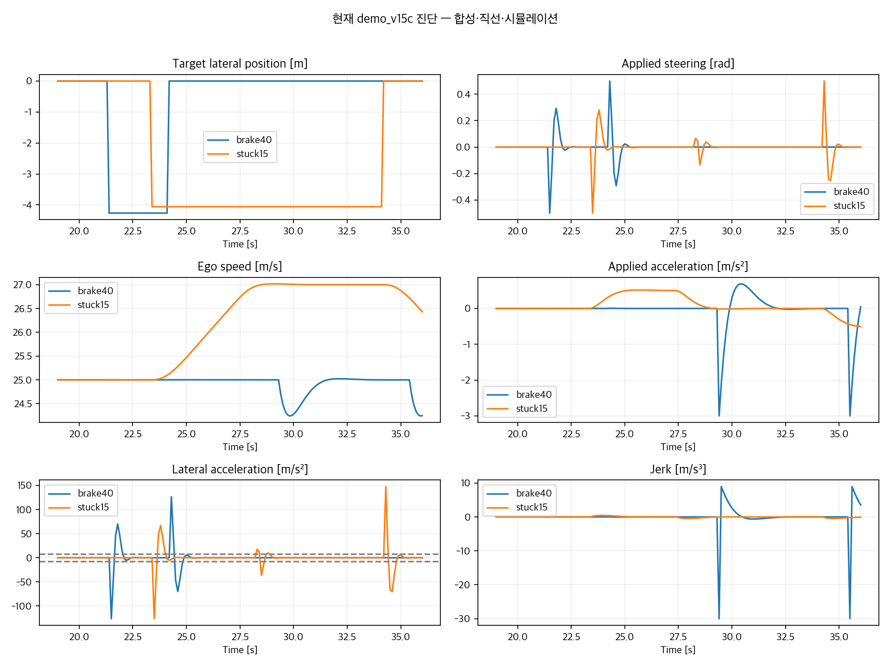

# demo_v15c — 1 단계 진단 보고 (구현 전)

2026-10-28. **합성·직선·시뮬레이션**. 실제 도로 성능이 아니다. 2 단계 설계 고정과 3 단계 구현/검증은 아직 하지 않았다.

## 결론

주원인은 **속도와 무관한 ±0.5rad 조향 허용, 횡가속·조향 변화율 하드 제한 부재, 3.78~4.26m 목표 횡위치의 순간 변경**이다. 여기에 NMPC 가 회피 때도 25m/s 를 유지하거나 27m/s 로 가속하는 정책이 결합돼 횡방향 급기동을 선택한다. 예측 위치 직접 대입이나 축 정렬 렌더링은 원인이 아니다.

규칙 백엔드에는 이미 종방향 제동이 있다. 그러나 접근속도 0.5m/s 미만이면 감속을 멈추므로, 작은 간격에서 천천히 재접근할 때 충돌한 사례가 있었다. 따라서 새 정책에는 TTC 뿐 아니라 정지/저속 접근 때의 간격 조건이 필요하다.

사용자 확인에 따라 **기존 demo_v15c 를 수정 대상**으로 삼는다. 기존 v15c 는 v14b B14b 누적기, 홀드 3 초, 기본 k_drain1.3 을 사용한다. 이를 그대로 보존한다. 요청 최초의 v15b 복사 지시는 기존 v15c 에 기능을 넣는 방향으로 정정됐으며, 덮어쓰기/기존 파일 수정은 하지 않았다.

## 측정 범위와 무변경 확인

현재 v15c 에서 사전 고정한 5 개 에피소드를 NMPC 와 rule 로 각각 1 회 실행했다(시드 0~4). 같은 v15b 측정 10 회는 비교용으로 보존했다. **이것은 3 단계의시나리오당 20 회 검증이 아니다.** 5 개 중 drift15 에서는 두 백엔드 모두 회피가 개시되지 않았다. 이를 성공한 회피로 바꾸거나 다른 시드로 대체하지 않았다.

각 60 초·600 스텝, 주입 20 초, 초기 속도 25m/s, σmeas=.1m, 배경 ON, 방향지시등 가정 ON. brake 는같은 차선, drift/stuck 은왼쪽 차선(+3.5m). 간격은초기 중심 간격 15/25/40m 이다. 배경 가감속 때문에 주입 시점 간격은초기값과 다르다. drift/stuck 은 30 초에기존키 0 으로해제했다.

원본 v15b, 기존 v15c 최상위 파일, planning/Config 를포함한 src 의 37 개파일은실행 전후 SHA-256 이동일했다. 검사 목록과 해시는 private 의 source_hashes_before.json 에있다. 새 진단 하네스만 추가했으며 탐지기·누적기·보정값·홀드·제어 정책을수정하지 않았다.

## 원인 후보별 판정과 영향 순위

**합성·직선·시뮬레이션**

| 가설 | 근거 수치·코드 | 판정 | 영향 순위 |
| --- | --- | --- | --- |
| 1. 상태 갱신/예측값 직접대입 | sim.py:125–129 는(a,r)로전진오일러. 기록 6000 스텝의직접 재계산 최대 차이 0. x_pred 는 app.py:315–318 에서점으로표시만. 수동은 sim.py:174–180 에서 v/ψ를먼저갱신. | 직접대입 아님. 공통 Vehicle/동일 step 은 아님. | 7 |
| 2. 조향각 한계 | δ최대 0.500rad; 전체 최대\|a_lat\|147.501m/s², \|r\|5.463rad/s. 25m/s·δ=.5 이면 126.459m/s². | 확인: 속도별 횡가속 제한 없음. 8m/s²의약 15.8 배(25m/s). | 1 |
| 3. 액추에이터/변화율 | NMPC 최대\|δdot\|5.000rad/s, jerk60.0m/s³. 수동 예시 0.015735rad/s, jerk1.5075m/s³. | 확인: 자차 입력 완화 없음. 비용함수의Δu 벌점은하드 한계가 아님. | 3 |
| 4. 제어/렌더 주기 | DT=.1s, clock.tick(60), 보간 없음. NMPC 첫 큰 회전에서 한 스텝 heading 변화약 29°, 전체 최대 31.30°. 풀이 최대 54.89ms, 100ms 초과 0/3000. | 10Hz 상태 ZOH 확인. 이번 헤드리스에서 제어 deadline 초과는미관측; GUI FPS 는미측정. | 6 |
| 5. target_y 불연속 | 회피 진입 0→−3.782/−4.230/−4.263/−4.056m. 복귀는 즉시 0m. 복귀 상태→정상은각 0.4 초. | 확인: 전체 1 초 예측 지평에 상수 목표 Y 를즉시 대입. | 2 |
| 6. fallback 개입 | 전체 72/39/62/0/0 회(합 173), AVOIDING 중 0 회. 모두 급제동 시나리오의 복귀 완료 뒤 NORMAL. −3↔가속으로최대 jerk60.0. | 발생 확인. 이번 회피의 급조향 원인은 아님; 복귀 후 종방향 급변 원인. | 5 |
| 7. 회전/슬립 | car()는 sin/cos 로회전된 4 꼭짓점. 시작 heading 정렬 slip 최대 7.1e−13°. 종료 heading 과차분 속도 비교 시 31.30°. | 축 정렬 아님. 실제 타이어 슬립 증거 없음; 큰종료 heading 차는시간 정렬/큰 적분 스텝 효과. | 원가설 기각 |
| 8. 종방향 회피 부재 | brake40 의 NMPC AVOIDING 동안\|a_cmd\|<.1 비율 100%, 속도기준 25m/s. stuck15 는기준최대 27m/s·양의 가속 명령 43.5%. rule 은−5 까지제동. | NMPC 정책에서감속 목표 없음. rule 까지감속 없다는 가설은 기각. 20m/s 하드코딩은 reset 에서 25 로교정됨. | 4 |
| 9. 수동복원 항 | r=r_cmd−ψ/1s. r_cmd 가 0 이면도로방향으로ψ를복원. 실제 r 과 r_cmd 가다름(수동 예시최대\|r\|.03257). | 키보드 자세 보조다. 공통 플랜트에넣지 않고 키보드 컨트롤러에 둘 것을 제안. | 분리 필수 |
| 10. 기타 | 화면횡 26px/m·종 10px/m(2.6 배왜곡), 1 스텝제어전달, 장애물예측시간 0.1s 불일치, 축정렬충돌검사, 뒤접근 TTC=∞. | 모두 코드 확인. 통합 플랜트만으로 자동 해결되지 않음. | 보조/설계 제약 |


행번호는현재 v15c 기준이며 v15b 의 sim.py/ego_controller.py 와같다. “영향순위”는소스와관측에기반한진단판단이다. 파라미터 ablation/튜닝으로인과효과크기를추정한것은아니다.

## 자차와 수동차량 갱신 비교

**합성·직선·시뮬레이션**

| 항목 | 현재 자차 | 현재 수동 이웃 |
| --- | --- | --- |
| 입력 | [a_cmd,δ]→r=v·tanδ/2.7; 다음 10Hz 스텝에적용 | 키 W/S→2 초 a 램프; A/D→r_cmd 램프/해제감쇠 |
| 속도/heading | v_old·cosθ_old, v_old·sinθ_old 로위치갱신후 v/θ업데이트 | 먼저 v_new 와ψ_new 계산후그값으로 x/yk 업데이트 |
| 위치 | X+=v_old cosθ_old dt; Y+=v_old sinθ_old dt | x+=v_new cosψ_new dt; yk+=v_new sinψ_new dt |
| heading | θ+=r dt; 자동도로방향복원없음 | ψ+=(r_cmd−ψ/1s)dt |
| 공통성 | 같은 Sim 컨테이너안별도 step_ego 메서드 | 같은 Sim 컨테이너안 step 내인라인구현; 별도 Vehicle 클래스없음 |
| 추가횡이동 | 없음 | 배경 bg_y 와이상 y_inj 를운동학위치에더함. 센서 heading 은후진차분으로재구성 |


따라서“수동차와완전히동일한플랜트”요구는현재두운동학부분을합치는것외에도배경·drift·stuck 주입경로를어떻게다룰지정해야한다. 기존이웃주입은일부가위치오프셋을직접더하며공통 Vehicle.step 을우회할수있다. 탐지파라미터는유지하더라도입력궤적이바뀌면탐지시점은바뀔수있다.

## 5 개 에피소드: 실제 최댓값

**합성·직선·시뮬레이션**

| 백엔드 | 에피소드 | 회피시작 s | \|δ\| rad | \|a_lat\| m/s² | \|δdot\| rad/s | \|r\| rad/s | \|jerk\| m/s³ | FB 전체/회피 | 충돌 | 최소간격 m |
| --- | --- | --- | --- | --- | --- | --- | --- | --- | --- | --- |
| nmpc | brake15 | 20.2 | 0.500 | 130.34 | 5.000 | 5.135 | 60.00 | 72/0 | 0 | 1.952 |
| nmpc | brake25 | 21.1 | 0.500 | 126.46 | 5.000 | 5.058 | 59.35 | 39/0 | 0 | 2.483 |
| nmpc | brake40 | 21.4 | 0.500 | 126.46 | 5.000 | 5.058 | 60.00 | 62/0 | 0 | 2.703 |
| nmpc | drift15 | N/A | 0.000 | 0.00 | 0.000 | 0.000 | 0.00 | 0/0 | 0 | 10.601 |
| nmpc | stuck15 | 23.4 | 0.500 | 147.50 | 5.000 | 5.463 | 0.46 | 0/0 | 0 | 4.501 |
| rule | brake15 | 20.2 | 0.017 | 0.96 | 0.101 | 0.078 | 65.00 | 0/0 | 1 | 0.000 |
| rule | brake25 | 20.2 | 0.008 | 0.78 | 0.064 | 0.048 | 65.00 | 0/0 | 1 | 0.000 |
| rule | brake40 | 20.2 | 0.017 | 0.96 | 0.106 | 0.078 | 65.00 | 0/0 | 1 | 0.000 |
| rule | drift15 | N/A | 0.000 | 0.00 | 0.000 | 0.000 | 0.00 | 0/0 | 0 | 10.601 |
| rule | stuck15 | 27.2 | 0.002 | 0.52 | 0.025 | 0.022 | 33.85 | 0/0 | 0 | 8.827 |


표는전체 60 초의최댓값이다. 회피구간만의분포는다음표와 private/summary.json 에별도기록했다. NMPC 충돌 0 은현실적차량에서안전했다는뜻이아니다. 126~148m/s² 횡가속을허용하고방향각을무시한충돌박스로측정한결과다. rule 의급제동 3 건은각 1 회충돌했고숨기지않았다.

### 회피 중 가속과 목표속도

**합성·직선·시뮬레이션**

| NMPC 에피소드 | AVOIDING 표본 | 적용 a 최소/최대 m/s² | \|a_cmd\|<.1 | a_cmd<−.1 | a_cmd>.1 | 전체 v_ref 최소/최대 |
| --- | --- | --- | --- | --- | --- | --- |
| brake15 | 22 | -0.171/0.428 | 27.3% | 9.1% | 63.6% | 25.00/25.60 |
| brake25 | 31 | -0.133/0.229 | 54.8% | 22.6% | 22.6% | 25.00/25.30 |
| brake40 | 28 | -0.011/0.001 | 100.0% | 0.0% | 0.0% | 25.00/25.00 |
| drift15 | 0 | N/A/N/A | N/A% | N/A% | N/A% | 25.00/25.00 |
| stuck15 | 108 | -0.015/0.515 | 56.5% | 0.0% | 43.5% | 25.00/27.00 |


brake15/25 에서도회피중적용감속최댓값은약 0.171/0.172m/s²수준이다. 전체 60 초최소가속−3 은주로이후 fallback 이므로회피제동성능으로세지않는다. 앞차가급제동해도상태머신은관측속도가 16m/s 이상이면기준속도+2 를요구하고, 그미만이면 25m/s 를유지한다.

Config 가중치는위치 0.8, 속도 1.0, 가속입력 0.1, 조향입력 0.2, 입력변화 5, slack2000 이다. 서로단위가다른Δa 와Δδ를같은계수로제곱하므로, 정지명령에서−5m/s²로변경하는한 단계 벌점은 125 이고δ=.5rad 변경은 1.25 다. 횡가속하드 제한없이횡변위를빠르게만들수있어횡회피가저렴해진다는해석이다. 비용차이를분리한실험은하지않았다.

NMPC 예측지평은 10×.1=1 초다. 최대 soft slack 은 stuck15 에서 1.045m(종방향스케일타원제약단위)이며나머지는약.00012~.00021m 였다. slack 은실제차체침범량이아니다. 높은 slack 가중치도충돌회피의수학적보장을제공하지않는다.

### 저크·조향 변화율·풀이시간 분포

**합성·직선·시뮬레이션**

| 백엔드 | 에피소드 | 구간 | n | \|jerk\| p50/p90/p99/max | \|δdot\| p50/p90/p99/max | 풀이 ms p50/p90/p99/max |
| --- | --- | --- | --- | --- | --- | --- |
| nmpc | brake15 | all | 600 | 0.000/26.286/60.000/60.000 | 0.000/0.000/1.154/5.000 | 13.029/29.183/41.715/46.903 |
| nmpc | brake15 | avoiding | 22 | 0.428/0.819/0.838/0.842 | 0.030/3.009/4.785/5.000 | 2.830/12.101/19.106/19.950 |
| nmpc | brake25 | all | 600 | 0.014/12.565/43.940/59.352 | 0.000/0.000/1.270/5.000 | 12.012/24.699/40.209/47.926 |
| nmpc | brake25 | avoiding | 31 | 0.118/0.479/0.647/0.657 | 0.002/1.249/4.602/5.000 | 2.236/12.542/20.753/23.197 |
| nmpc | brake40 | all | 600 | 0.001/23.144/58.455/60.000 | 0.000/0.000/1.279/5.000 | 12.793/29.298/46.043/54.886 |
| nmpc | brake40 | avoiding | 28 | 0.001/0.011/0.099/0.105 | 0.007/1.870/4.645/4.993 | 2.456/9.781/18.451/19.370 |
| nmpc | drift15 | all | 600 | 0.000/0.000/0.000/0.000 | 0.000/0.000/0.000/0.000 | 1.880/2.116/2.289/2.794 |
| nmpc | drift15 | avoiding | 0 | N/A | N/A | N/A |
| nmpc | stuck15 | all | 600 | 0.000/0.113/0.446/0.461 | 0.000/0.000/1.837/5.000 | 2.017/2.187/2.593/4.112 |
| nmpc | stuck15 | avoiding | 108 | 0.012/0.379/0.452/0.455 | 0.000/0.332/3.580/5.000 | 2.006/2.179/3.474/4.112 |
| rule | brake15 | all | 600 | 0.000/0.127/65.000/65.000 | 0.000/0.006/0.092/0.101 | 0.000/0.000/0.000/0.000 |
| rule | brake15 | avoiding | 185 | 0.000/0.000/65.000/65.000 | 0.002/0.020/0.095/0.101 | 0.000/0.000/0.000/0.000 |
| rule | brake25 | all | 600 | 0.000/0.000/65.000/65.000 | 0.000/0.009/0.058/0.064 | 0.000/0.000/0.000/0.000 |
| rule | brake25 | avoiding | 319 | 0.000/0.000/65.000/65.000 | 0.001/0.009/0.060/0.064 | 0.000/0.000/0.000/0.000 |
| rule | brake40 | all | 600 | 0.000/0.000/65.000/65.000 | 0.000/0.018/0.098/0.106 | 0.000/0.000/0.000/0.000 |
| rule | brake40 | avoiding | 350 | 0.000/20.000/65.000/65.000 | 0.002/0.020/0.099/0.106 | 0.000/0.000/0.000/0.000 |
| rule | drift15 | all | 600 | 0.000/0.000/0.000/0.000 | 0.000/0.000/0.000/0.000 | 0.000/0.000/0.000/0.000 |
| rule | drift15 | avoiding | 0 | N/A | N/A | N/A |
| rule | stuck15 | all | 600 | 0.000/0.037/30.000/33.855 | 0.000/0.001/0.005/0.025 | 0.000/0.000/0.000/0.000 |
| rule | stuck15 | avoiding | 166 | 0.000/0.000/31.283/33.855 | 0.000/0.002/0.023/0.025 | 0.000/0.000/0.000/0.000 |


rule 의 solve_ms=0 은최적화풀이가없다는기록값이며규칙계산이실제로 0ms 라는벤치마크가아니다. NMPC3000 회중 100ms 초과는 0 회였다. 탐지·그리기·이벤트처리까지포함한 GUI 프레임시간은측정하지않았다.

### fallback 와 복귀

fallback173 회는모두 AVOIDING 종료후 NORMAL 에서발생했다. 첫발생시각은 brake15 37.3 초, brake25 31.5 초, brake40 29.3 초이고당시이웃은각각약 193/77/70m 뒤에있었다. 기존 fallback 은−3m/s²와δ=clip(−θ−0.5Y,±.5)다. 이샘플에서는 Y≈0 이므로 fallback 이횡회피를원래 차선으로강제취소했다는증거는없다. 반면회복가속과 fallback 감속의교대는약 60m/s³저크를만들었다. Solver 의상세실패상태/잔차는수집하지않아“왜먼장애물에서실패했는가”는아직확정하지못했다.

현재복귀조건은τ회복이아니라 dx<−5m(완전히추월)뿐이다. stuck15 에서는τeff>.7 인데도 AVOIDING 에남은표본이합 2.7 초였다. 이번에는결국추월해복귀했으므로“영원히복귀하지않음”을관측했다고주장하지않는다. 구조적으로동일속도·전방간격을유지하면회복된τ만으로복귀할분기가없다.

### 추가 원인: rule 의 저속 접근 사각지대

brake25 는 46.7 초, brake40 은 45.6 초에충돌했다. 그순간τeff 는각.411/.329 로경보가켜져있었지만 a_cmd=0 이었다. 이웃중심간격은 4.477/4.498m, 접근속도는약.030/.038m/s 여서 danger 의 closing>.5 조건에서탈락했다. 4.5m 차체길이보다간격이작아지는것을 TTC 또는접근속도조건만으로막지못한사례다. brake15 는 22.1 초에−5m/s²제동중충돌해여유부족사례에해당한다.

### 렌더링과 헤딩

차량사각형은이미헤딩 sin/cos 로회전한다. 60FPS 그리기는마지막 10Hz 상태를반복표시하며보간하지않는다. 횡 26px/m 와종 10px/m 는동일길이척도가아니어서화면각도는 arctan(2.6tanθ)로왜곡된다. 이는물리슬립이아니며원래의큰헤딩점프를과장한다. 예측 x_pred 는점열오버레이일뿐실제위치갱신에사용되지않는다.

자차의차분속도방향과**스텝시작 heading**은최대 7.1e−13°로같다. 스텝끝 heading 과비교하면최대 31.30°차이가난다. 전진오일러가이전 heading 으로이동한뒤새 heading 으로회전하기때문이다. 물리타이어슬립각이 31°라는뜻이아니며, 앞으로의 5°판정에서도동일시간 정렬을고정해야한다.



## 수동 입력의 실제 설정과 요청 문구의 불일치

**합성·직선·시뮬레이션**

| 항목 | 현재 v15c/v15b 값 | 해석 |
| --- | --- | --- |
| 키 W / S | +1.5 / −3m/s² | 요청의“수동 S 와같은−8”과다름. 공통 플랜트−8 과키보드기본−3 은분리가능. |
| 가속램프 | A_RAMP_T=2 초 | 키목표가바뀔때현재값에서선형램프. 일반적인고정 jerk 하드 상한은아님. |
| 요레이트램프 | R_RAMP=.05rad/s² | 키를누를때 r_cmd 변화율. 조향각δ변화율이아님. |
| 요레이트명령상한 | R_MAX=.05rad/s | 복원항이적용되기전명령상한. 속도별 8m/s²한계와별개. |
| 해제감쇠 | R_REL=.3 초 | 키를놓았을때만 exp(−dt/.3)적용. 상시액추에이터지연은아님. |
| heading 복원 | T_PSI=1 초 | 도로 방향으로 돌리는 키보드 보조. 플랜트에서 분리할 것을 제안. |
| wheelbase | 수동에는 L 없음; NMPC Config L=2.7m | 요청에서허용한 2.7m 를공통모델기준으로쓸수있음. |


고정수동 예시(bg=False,D3 초·W2 초·S2 초)에서|a_lat|max=.81415m/s², |r|max=.032566rad/s, 역산δmax=.003517rad, |δdot|max=.015735rad/s, |jerk|max=1.5075m/s³였다. 이는선택된입력예시의관측값이지새플랜트한계로채택한값이아니다.

25m/s 에서 8m/s²에대응하는조향각은 atan(2.7×8/625)=.03455rad, 정상 4m/s²는.01728rad 다. 기존 R_RAMP=.05rad/s²를고정속도 25 에서조향변화율로바꾸면약.0054rad/s 다. 속도와δ에따라변환이달라지므로근거없이상수 steer_rate_max 를새로정하지않았다.

## 수정 방향 제안 — 아직 설계 확정/구현하지 않음

- 공통 Vehicle.step 에기구학·입력상태·한계·적분을모으고, 키보드의도로방향복원과목표램프는입력생성계층으로분리한다.

- 속도에따른횡가속한계와조향변화율하드 제한을두고, NMPC 출력이클립된빈도와실제로적용된입력을기록한다. Config/가중치는그대로둔다.

- NMPC 에는 TTC 단계별 target_velocity 를낮추는어댑터와제동명령을추가하고, 큰 target_y 점프는시간연속참조로완화한다. 예측모델과새플랜트의액추에이터차이는별도기록해야한다.

- τ회복 2 초+간격조건을통한복귀와원차선/속도추종을데모서브클래스로정의한다. 원 planning.py 는읽기전용으로유지한다.

- TTC=∞인느린접근, 뒤에서접근, 옆차선점유를정책에서분리한다. 뒤차가위험하게접근할때무조건제동하는정책은간격을더줄일수있다.

- 플랜트를더작은 dt 로공통적분하거나렌더링보간을쓰고, 화면척도/정렬문제를함께정리한다. 3 단계의충돌지표에는기존축정렬검사의한계를표기한다.

## 2 단계 전에 필요한 확인

1. **기준버전:** 사용자확인완료. 기존 demo_v15c 의 B14b 누적기·탐지기·보정·홀드·기본 k_drain 을유지하고회피만추가한다.

2. **공통 플랜트한계와키입력:** 공통 물리 한계는 요청대로 +3/−8 로두고, 현재키보드목표+1.5/−3 및 2 초램프는유지하는 안을 제안한다. S 키자체도−8 로바꿀지는사용자 결정이 필요하다.

3. **공통액추에이터규약:** 현재 코드에는 고정조향각변화율/상시 1 차지연의“같은값”이없다. 새 상수를 만들지 않도록 기존.05rad/s²와.3 초를요레이트명령 공간의 공통 변화율/지연으로재사용하고 δ로변환하는안을제안한다. 이는기존 키 해제 전용 감쇠를 상시 액추에이터로 일반화하는 설계 변경이므로확인이 필요하다.

4. **뒤차접근:** 제시된 TTC 제동 단계를앞/횡충돌위험에적용하고, 뒤차 단독 접근에는 제동을 기본 반응으로 강제하지 않는 방향을 제안한다. 요청문구를모든 접근 방향에 그대로 적용하면 후방 간격이 악화될 수 있다.

방향 확인 후에만 README 의 2 단계설계를 고정하고 구현한다. 원본문서의“1 단계진단→내확인→2·3 단계”요청 때문에 여기서 멈춘다. 도구/스킬의별도 승인 요구 때문이 아니다.

## 파일·실행·Git 명령 (실행하지 않음)

새파일만추가: `DIAGNOSIS_PHASE1.md`, `diagnosis_v15b/DIAGNOSTIC_PLAN.md`, `diagnosis_v15b/diagnose.py`, `diagnosis_v15b/make_report.py`, 진단그림, `private/`로그·JSON. 기존 README 와실행코드는수정하지 않았다. 폴더명의 v15b 는최초진단시작경위를보존하며현재주결과는 private/v15c/에있다.

```sh
# Drive에서실행. 결과를다시만들때기존private로그를보존할것.
/opt/anaconda3/bin/python -I -B demo_v15c/diagnosis_v15b/diagnose.py demo_v15c
/opt/anaconda3/bin/python -I -B demo_v15c/diagnosis_v15b/make_report.py
```

원시로그·JSON 은 UAH 요약값에의존하는합성궤적이므로 private/에서보존하고공유/커밋하지않는다. UAH-DriveSet: Romera, Bergasa, Arroyo, ITSC2016; 비상업연구용·재배포금지. 보고서와그림은집계/사례요약이다.

```sh
# 아래는검토용명령일뿐실행하지않음
cd "/Users/mac/Documents/Claude/Projects/논문 만들기/Drive/v2v_trust_planning"
git switch -c demo-v15c-avoidance-diagnosis
mkdir -p reports/demo_v15c/diagnosis
cp ../demo_v15c/DIAGNOSIS_PHASE1.md reports/demo_v15c/
cp ../demo_v15c/diagnosis_v15b/DIAGNOSTIC_PLAN.md reports/demo_v15c/diagnosis/
cp ../demo_v15c/diagnosis_v15b/diagnose.py ../demo_v15c/diagnosis_v15b/make_report.py reports/demo_v15c/diagnosis/
# private/ cache/ *.pt UAH原本/파생물은추가하지않음
git add reports/demo_v15c/DIAGNOSIS_PHASE1.md reports/demo_v15c/diagnosis/*.md reports/demo_v15c/diagnosis/*.py
git diff --cached --name-only
git commit -m "Diagnose demo_v15c vehicle dynamics and avoidance before implementation"
```

복사본은보존용이다. 실행재현은원래 Drive 디렉터리배치와비공유로컬의존성을필요로한다.
