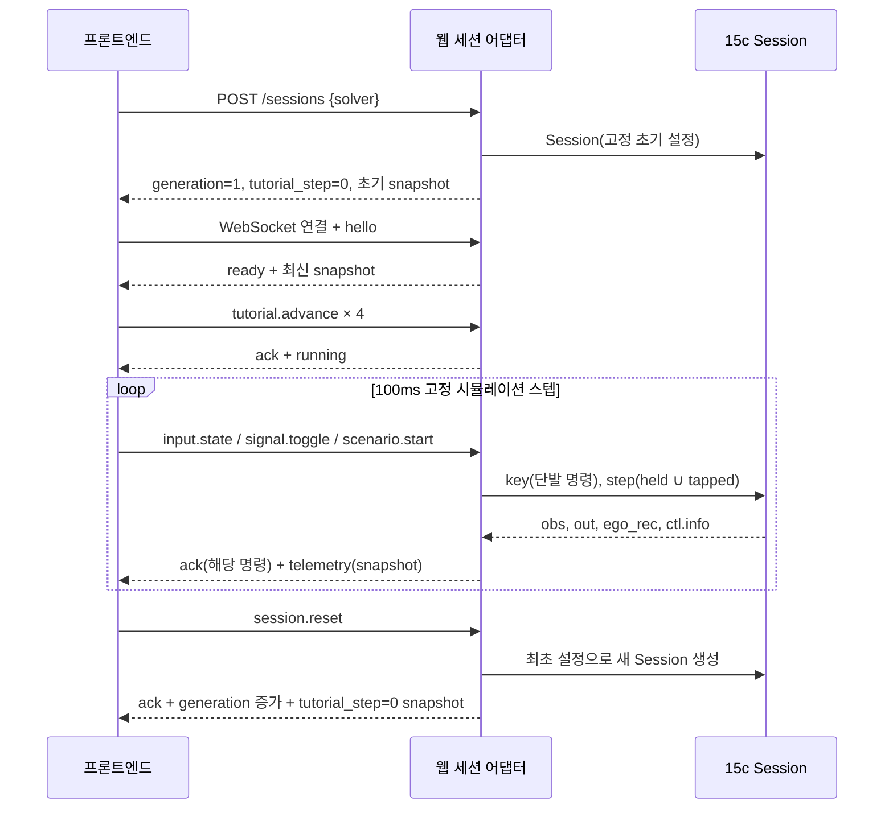

# 15c 실시간 차량 시연 웹사이트 기술 명세서

작성일: 2026-10-29 · 개정: 2026-11-01 · 명세 버전: 1.4 (자동 모드(가상 운전자) 추가) · 프로토콜: `v1` · 기준: `demo_v15c`

대상: 프론트엔드, 백엔드, 모델 연동 담당자, QA.

**이 문서는 구현 계약이다. 아래 HTTP/WebSocket API는 새로 구현할 규격이며 현재 15c에 존재하는 API가 아니다.** 현재 구현은 Python 시뮬레이션과 Pygame 화면이다. 기존 모델·시뮬레이션 소스는 변경하지 않고 웹 어댑터를 추가하는 것을 기준으로 한다. 함께 제공하는 [web-demo-contracts.ts](web-demo-contracts.ts)는 요청·응답의 필드와 타입을 정의한다. 본문의 동작·검증 규칙과 함께 적용한다.

### 변경 요약 (v1.3 → v1.4)

웹 어댑터에 **자동 모드(가상 운전자)** 를 추가했다. 15c 알고리즘(`demo_v15c`의 시뮬레이션·탐지·누적·자차 회피)은 바뀌지 않는다. 계약은 **하위 호환 추가만** 했고 `protocol_version`은 `v1` 그대로다. 자동 모드를 켜지 않은 세션의 동작은 v1.3과 같다. 동작 규칙은 1.3절.

| 항목 | v1.3 | v1.4 |
|---|---|---|
| 이웃차 조종 | 시연자가 WASD·Q/E·1~5로 직접 | 직접 조종(기본) **또는** 세션 생성 때 `auto_drive=true`로 서버의 가상 운전자가 조종 |
| `CreateSessionRequest` | `{solver?}` | `{solver?, auto_drive?, auto_seed?}` |
| `HealthResponse` | — | `auto_drive_available` 추가(샘플·목업은 false) |
| `Snapshot` | — | 선택 필드 `auto?: AutoDriveStatus` 추가 |
| 입력 TTL | running 이면 항상 적용 | 자동 모드 세션에는 적용하지 않음(연결 생존 ping 규칙은 유지) |

### 변경 요약 (v1.2 → v1.3)

v1.2 이후 사용자 결정으로 자차 동작이 다시 바뀌었다. **API·메시지·[web-demo-contracts.ts](web-demo-contracts.ts)의 필드는 바뀌지 않는다.** 값의 의미와 서버 동작만 달라진다. v1.2 원문은 [WEB_DEMO_TECH_SPEC_v1.2.md](../WEB_DEMO_TECH_SPEC_v1.2.md)에 보존했다.

| 항목 | v1.2 | v1.3 (현재 코드) |
|---|---|---|
| 자차 조향 한계 | 두 차량 공통 요가속 0.05rad/s² | **자차만 0.3rad/s²**(합성 설정값). 이웃은 0.05 그대로이며 궤적이 비트 단위로 같다. 클래스·step·그 밖의 한계는 공통 |
| 차선변경 시간 (25m/s) | 약 6초 | **약 3.6초** |
| 차선변경 조건 | 3≤TTC≤4 창 안에서만 | **TTC≤4이고 옆 차로가 비면 즉시**. 아직 움직이기 전이면 반대쪽 차로도 후보 |
| 제동 | 위험 단계별 고정값(0/−5/−8) | **종·횡 연동**: 횡 이동으로 이웃 차체를 벗어날 때까지 범퍼 간격 2m를 지키는 최소 감속(+이웃 관측 감속). 단계 값은 상한 |
| 횡으로 벗어난 뒤 | 다른 차로에 안착해야 속도 회복 | 이웃 차체와 횡으로 겹치지 않으면 바로 제동 해제·속도 회복 |
| 뒤차 단독 위협 | 제동 안 함(가속 0) | 제동 안 함, TTC≤4에서 **+3m/s² 가속**으로 벗어남 |
| 평소 주행 | 앞차가 있어도 25m/s 정속 | **앞차 따라가기**: 같은 경로 앞차에 시간 간격 1.5초 + 정지 간격 5m 유지, 신뢰도와 무관. 이 감속 단독은 −3.5m/s² 이하 |
| 회피 모드 | combined 공개, off/lateral은 내부 비교 모드 | **combined 하나만 존재**(off/lateral 삭제) |

### 변경 요약 (v1.1 → v1.2)

v1.1은 v15c-fix 이전 코드 기준이었다. 당시 자차는 차선을 무시하고 발산했고(검증 800회 중 최대 |Y| 241m, NMPC는 160/160 도로 이탈·정지), 화면은 26px/m로 확대돼 40m 앞 이웃차가 처음부터 보이지 않았다. v1.2는 수정된 현재 코드를 기준으로 한다. v1.1 원문은 [WEB_DEMO_TECH_SPEC_v1.1.md](../WEB_DEMO_TECH_SPEC_v1.1.md)에 보존했다.

| 항목 | v1.1 | v1.2 (현재 코드) |
|---|---|---|
| 화면 척도 | scaleX=scaleY=26px/m | **11px/m**, 종·횡 동일. 원본 기준 전방 ≈55m·후방 ≈16m 표시 (3.1) |
| 자차 횡목표 | 정책이 ±0.5/±3.5 상수를 지정 | **차선 고정**: {차로 중심, 중심±0.5m}에만 스냅. 차선선 위·도로 밖 목표 없음 (1.2) |
| 횡참조 | 시간 기반 5차 4초(차선변경)/2초(비킴) | **거리 기반 5차 y(x)**, 공통 Vehicle 한계의 60% 안으로 길이 자동 결정. 25m/s 차선변경 약 6초 |
| rule 추종 | ω=1, ζ=1, 변화율 포화로 발산 | 공통 추종기 `track()` ω=0.4, ζ=1, 앞먹임+요레이트 명령 변화율 제한 |
| nmpc | NMPC 조향을 그대로 Vehicle에 적용 | **NMPC = 계획기**. 가속은 NMPC 값. 횡은 NMPC 예측 끝점의 정책 경로 대비 편차를 차선 격자 목표로 바꿔 같은 추종기가 실행. NMPC 조향은 Vehicle에 직접 들어가지 않음 |
| 옆 차로 안착 후 | 위험이 사라질 때까지 감속한 속도 유지 | 이웃과 다른 차로에 안착하면 속도 회복 → 추월 → 원래 차로 복귀 |
| 자차 목표 필드 | target_y 하나 | 추종 중 목표 `target_y`(active)와 정책 목표 `policy_target_y`, NMPC 오버라이드 여부 분리 (7) |

## 1. 구현 범위와 기본 결정

| 항목 | 요구사항 / 결정 |
|---|---|
| 차량 | 자차 1대 + 시연자가 운전하는 이웃차 1대 |
| 도로 | 직선 3차로, 차로 폭 3.5m, 차량 크기 4.5 × 1.8m |
| 왼쪽 화면 | 두 차량의 위치·방향·이동·이웃차 깜빡이·탐지/반응 경보 표시 |
| 오른쪽 화면 | 실시간 신뢰도 그래프, 점수·누적량·자차 반응·시나리오 상태 |
| 오른쪽 아래 | 실제 키보드 배열의 Q/W/E, A/S/D; 숫자 1~5와 R도 별도 행에 표시 |
| 조작 | WASD 연속 입력, Q/E 토글, 1~5 사전 정의 움직임, R 전체 초기화 |
| 첫 진입 | 원래 화면 위 검정 반투명 안내, WASD → QE → 12345 → R, 총 4단계 |
| 안내 진행 | Enter 또는 새 키 누름/안내 영역 클릭으로 다음 단계; 진행 입력은 운전에 전달하지 않음 |
| 초기화 | 차량·속도·신뢰도·모델 내부 상태·그래프·시나리오·깜빡이·입력·안내를 모두 초기화 |
| 실시간 기준 | 서버 시뮬레이션 10Hz, 상태 전송 10Hz, 브라우저 렌더링 목표 60fps |
| 상태 권한 | 서버가 차량·모델·시간·안내 단계의 원본 상태를 관리 |
| 제어 기본값 | 회피 모드 `combined`(횡+종) 고정, 계산 엔진 `rule` 기본 / `nmpc` 선택 |
| 안내 중 시간 | **정지**. 4단계 안내 완료 뒤 실시간 시작. 안내를 읽는 동안 차량이 움직이지 않게 하는 웹 추가 결정 |
| 공개 조정 범위 | 시작 전 자차 제어 방식만 선택. 시드·잡음·초기 위치·누적기 파라미터는 고정 |
| 자차 차로 규칙 | 서버 정책이 자차 횡목표를 차로 중심/중심±0.5m로 제한. 웹은 자차 위치를 보정·clamp하지 않고 서버 상태를 그대로 그림 |
| 자차 평소 주행 | 앞차 따라가기(1.2절). 같은 차로 앞차가 느리면 자차도 느려지는 것이 정상 동작이며 웹이 속도를 보정하지 않음 |
| 보조 기능 | 지속 시나리오 해제 버튼 및 `0` 키. R로도 해제되지만 R은 모든 상태를 초기화 |

기본값은 seed=0, sigma_meas=0.1, signal_assumption=true, bg=true, gap=40m, lane=2, 이웃차/자차 속도=25m/s(90km/h), k_drain=1.3이다. 자차는 중앙 차로, 이웃차는 왼쪽 차로에서 40m 앞에 생성한다. `bg`는 추가 차량이 아니라 합성 주행 흔들림·배경 가감속이다. **이 기본 배치에서는 이웃차가 다른 차로에 있으므로, 4(급제동)를 눌러도 자차는 반응하지 않는 것이 정상 동작이다.** 자차 회피를 보려면 시연자가 A/D로 이웃차를 자차 차로로 넣거나 1(드리프트)로 자차 쪽으로 진입시켜야 한다. 이를 안내 2단계 문구와 상태 표시로 알린다(3.3). Pygame 원본에는 `--lane`/`--gap` 실행 옵션이 있지만 공개 웹 설정에는 노출하지 않는다. `demo_v15c.json`의 20초 급제동/70초 급가속 예약은 헤드리스 예제이며 웹에 자동 적용하지 않는다.

### 1.1 회피 모드와 계산 엔진

현재 코드는 **회피 모드 `backend`와 계산 엔진 `solver`를 구별**한다. 공개 웹은 회피 모드를 `combined`(횡+종)로 고정하고, 시작 전 solver를 rule/nmpc 중 선택한다. v1.3부터 원본에도 `off`(개입 없음)·`lateral`(횡만) 모드가 없다. `EgoController`의 모드는 `combined` 하나이며 C 키 전환도 삭제됐다. API의 `control_mode=combined`를 Python `Session(backend="combined", solver=...)`로 연결한다. 과거 `backend=rule/nmpc` 별칭에 의존하지 않는다.

| 엔진 | 같은 회피 정책을 실행하는 방식 | 웹 처리 |
|---|---|---|
| `rule` | 공통 상태머신이 차선 고정 횡목표와 속도 목표를 정하고, 실행 가능 거리 기반 참조를 공통 추종기 `track()`가 조향각 명령으로, 속도 오차를 가속 명령으로 변환 | 기본값 |
| `nmpc` | 같은 정책의 기준 참조(`ref_at(base=True)`)와 신뢰도별 안전거리를 최적화기에 전달. horizon=10, dt=0.1초. **가속은 NMPC 해, 조향은 NMPC 해를 쓰지 않는다.** NMPC 예측 끝점(1초 뒤)의 기준 참조 대비 편차가 0.25m를 넘으면 `정책 목표+편차`를 차선 격자로 스냅해 일시 오버라이드 목표로 두고, 같은 `track()`가 실행. 편차가 사라지면 정책 목표로 돌아감 | 선택값. 풀이 시간·fallback·예측 궤적·오버라이드 표시 |

둘 다 15c 탐지·누적의 `tau_eff`를 사용한다. `alarm_eff`도 함수 인자로 전달되지만 현재 회피 정책은 전달된 alarm 대신 **tau_eff≤0.7**과 관측 기하로 위험을 판정한다. 따라서 모델의 반응 경보와 제어기의 실제 개입은 같은 boolean이 아니다. GRU가 직접 조향을 생성하는 구조가 아니다.

공통 정책은 앞/뒤 60m, 4초 횡방향 예측의 경로 겹침, 종·횡 접근을 함께 판단한다. 위험 단계 1(TTC>4초)은 반대편 0.5m 비킴·가속 중지, 단계 2(2<TTC≤4), 단계 3(TTC≤2)이다. **단계 값 −5/−8m/s²는 제동 상한**이고, 실제 제동은 아래 1.2의 종·횡 연동 규칙이 정한다. TTC≤4이고 자차 원래 차로(중앙, y=0) 옆 차로가 비어 있으면 그 차로 중심(±3.5m)으로 바로 차선변경한다. 뒤차만 접근하면 제동하지 않고, TTC≤4에서 +3m/s²로 가속한다. 실제 가속·조향은 공통 액추에이터 지연과 제한을 거친다.

### 1.2 자차 횡방향 규칙 (v15c-fix)

| 규칙 | 현재 코드 | 근거 |
|---|---|---|
| 허용 횡목표 | `snap_lateral`: 차로 중심 {−3.5, 0, 3.5} ± {0, 0.5}m, 9개 값 중 최근접. 최대 \|y\|=4.0m, 차체 끝 4.9m < 도로 끝 5.25m | planning_demo.py |
| 참조 생성 | `set_target`: 현재 y·기울기·곡률에서 목표까지 거리 기반 5차. 길이 S≥20m, 설계 속도에서 요가속 ≤0.6×0.3rad/s²(자차 한계 `EGO_RAMP`), 횡가속 ≤0.6×4m/s²가 될 때까지 10%씩 증가 | planning_demo.py (ETA=0.6, S_MIN=20), vehicle.py `EGO_RAMP` |
| 설계 속도 | 회피 목표는 현재 속도, 복귀 목표는 max(현재 속도, 25m/s) | planning_demo.py |
| 추종 | `track()`: r = r_ff − (ω²/v)·e_y − 2ζω·e_θ, ω=0.4rad/s, ζ=1. r_ff는 참조 곡률을 0.3초 미리봄. r 명령은 스텝당 0.3×0.1rad/s 이내로 변화율 제한 후 δ=atan(L·r/v) | ego_controller.py |
| 최종 제한 | 정상 횡가속 4m/s², 비상 8m/s²에 해당하는 조향각으로 클립 후 Vehicle 적용 | ego_controller.py |
| 차선변경 시점 | 위험이고 TTC≤4(`ESCAPE_TTC`), 옆 차로 중심 ±(3.5+1.8)/2 안에 이웃이 없으면 즉시. 자차가 원래 차로 중심 ±0.2m 안이면 반대쪽 차로도 후보 | planning_demo.py |
| 종·횡 연동 제동 | 같은 차로 전방 위협(\|dy\|≤1.8m): 횡 참조가 이웃과 중심 간 2.1m(`CLEAR_Y`)가 되는 시각 t_clear(+0.3초 지연)까지 범퍼 간격 2m(`GAP_MIN`)를 지키는 최소 등감속을 구하고, 이웃 관측 감속(`a_obs`)을 더한 뒤 단계 상한(0/−5/−8) 안으로 자름. 측면 진입(\|dy\|>1.8m)은 단계 상한값 그대로 | planning_demo.py `_time_to_clear/_required_decel` |
| 속도 회복 | 위험이 사라지거나 자차가 이웃과 횡으로 2.1m 이상 떨어지면 제동 해제, +0.5m/s²로 25m/s 회복 | planning_demo.py |
| 뒤차 단독 위협 | 제동 없음. 단계 2 이상(TTC≤4)이면 +3m/s² | ego_controller.py `REAR_ESCAPE_A` |
| 앞차 따라가기 | 신뢰도와 무관. 같은 경로(0<dx≤100m, \|dy\|<1.8m) 앞차의 속도를 0.5초 저역통과한 v_lead로 v_follow = v_lead + (범퍼 간격 − (5 + 1.5·v))/2. 출력 속도 명령 = min(정책 속도 명령, v_follow)이고 정책 속도 명령 자체는 낮추지 않음. 위험이 아닐 때의 감속은 −3.5m/s² 이하 | planning_demo.py `ACC_*`, ego_controller.py |
| 복귀 완료 | 원래 차로 ±0.1m, heading ≤5°, 속도가 min(25, v_follow) ±0.5m/s, 1초 유지 | planning_demo.py |

**표시상 유의점:** 자차 요가속 한계는 0.3rad/s²(합성 설정값, 실측 차량값 아님)이다. 25m/s 차선변경은 약 3.6초다. 웹은 이를 보간·가속 재생으로 바꾸지 않는다. 같은 차로 앞에 이웃이 있으면 평소 주행 중에도 자차가 앞차 속도에 맞춰 느려지고 간격(25m/s에서 약 42m)을 벌린다. 시연자가 "자차가 멈칫한다"로 오해하지 않도록 HUD에 `v_ref`와 간격을 함께 표시한다.

복귀에는 신뢰도 회복 2초와 간격 확보, 또는 추월/전방·도로 밖 이탈 조건을 사용한다. 정확한 경계와 단계는 `planning_demo.DemoStateMachine.update()`를 따른다. 규칙을 웹에서 다시 계산하지 않는다. 원본 `ego_rec.ttc`는 종방향 보조 TTC이고 **정책의 TTC는 횡 접근까지 고려한 별도 값**이다.

### 1.3 자동 모드(가상 운전자, v1.4)

자동 모드는 시연자 대신 서버가 이웃차를 조종하는 웹 어댑터 기능이다. 15c 코드는 그대로이며, 가상 운전자는 시연자와 **같은 입구**(WASD 눌림 집합, Q/E, 1~5/0)만 사용한다. 이웃 상태를 직접 바꾸지 않는다.

| 항목 | 규칙 |
|---|---|
| 켜기 | `POST /sessions` 본문 `auto_drive=true`. 세션 도중에는 바꿀 수 없다(바꾸려면 새 세션). R(초기화)은 같은 설정·같은 시드로 다시 시작 |
| 시드 | `auto_seed`(0 이상 안전 정수, 기본 0)는 가상 운전자의 난수에만 쓴다. 시뮬레이션 시드는 1절 기본값 그대로. 같은 시드·같은 solver면 같은 이벤트 순서 |
| 상태 | `cruise`(첫 대기 전) → `wait`(다음 이벤트까지 카운트다운) → `event` → `recover` → `wait` … 이벤트·회복 중에는 새 이벤트를 시작하지 않는다 |
| 이벤트 간격 | 이전 이벤트가 끝나고 **회복이 완료된 뒤부터** 8~20초(균등) |
| 이벤트 종류 | 시나리오 1~5, 차로 진입(`cut_in`: 방향지시등 → A/D로 자차 차로 쪽 진입 → 회복 때 원래 차로로 복귀). 6가지 균등 |
| 시나리오 종료 | drift/stuck/weave는 정해진 지속 시간 뒤 `0`(해제). brake/accel은 원본이 자동 종료할 때까지 기다린다 |
| 회복 완료 | 주입 없음, 방향지시등 꺼짐, 이웃이 자기 차로 중심 ±0.5m 안, 자차 상태 `NORMAL`이 함께 성립 |
| 도로 이탈 방지 | 매 스텝 `edge_margin_m = 5.25 − (\|y\| + 0.9)`. 여유가 1.0m보다 작으면 바깥쪽 A/D 금지·안쪽으로 복귀, 필요하면 시나리오 해제. 횡방향 시나리오는 이웃이 도로 중앙 쪽에 있을 때만 시작 |
| 입력 | 자동 모드에서 들어온 `input.state`와 운전 명령(`signal.toggle`, `scenario.*`)은 **오류 없이 무시**한다(운전 명령은 ack 하되 적용하지 않음). `session.reset/pause/resume`, `tutorial.advance`는 그대로 처리 |
| 입력 TTL | 적용하지 않는다. 3초 무응답 연결 종료(`paused/disconnected`)는 그대로 |
| 표시 | `Snapshot.auto`: 상태·이벤트 종류·다음 이벤트까지 남은 초·도로 가장자리 여유·최근 20개 로그. `inputs.held_applied`는 운전자가 쓴 키, `held_received`는 빈 배열 |

조정값(간격·확률·여유·키 유지 시간·지속 시간)은 `real/auto_driver.py` 맨 위 `AUTO` 한 곳에 둔다. 샘플 모드와 목업 서버는 자동 모드가 없으며 `auto_drive_available=false`, `auto.enabled=false`를 보낸다.

엔진을 바꾸려면 기존 세션을 종료하고 새 세션을 생성하여 안내부터 시작한다. R은 선택한 엔진과 최초 설정으로 돌아간다. NMPC solver 실패 시 원본 fallback 가속 −3m/s²를 쓰고(정책 제동이 더 강하면 정책 값), 조향은 정책 경로 추종으로 유지한다(Y=0 강제 복귀 없음). 이를 표시한다. 세션의 엔진 표시를 조용히 rule로 바꾸지 않는다.

## 2. 코드 근거와 보존해야 할 동작

| 근거 | 연동 대상 |
|---|---|
| [app.py](../../app.py), `Session.__init__/reset/key/inject/step/control` | 세션, 입력, 시뮬레이션→탐지→누적→자차 제어 순서 |
| [app.py](../../app.py), `run_ui` | 최근 600표본 그래프, HUD, 경보 테두리, 깜빡이, 화면 밖 차량 |
| [sim.py](../../sim.py), `Sim` | 10Hz 운동학, WASD, 깜빡이, 다섯 시나리오, 관측 잡음 |
| [detector.py](../../detector.py), `Detector/R1Online/KF2Online` | GRU, R1, R2, 10초 준비 구간, 의도 구간 |
| [accum.py](../../accum.py), `Online/Zone` | B14b 누적기, S/S′/S_eff, 탐지/반응 신뢰도, 상대 구역 |
| [ego_controller.py](../../ego_controller.py) `EgoController.step/track/nmpc_goal` | 엔진 선택(모드는 combined 하나), 공통 추종기, NMPC 계획기 연결과 fallback, 뒤차 위협 가속, 앞차 따라가기 감속 상한 |
| [planning_demo.py](../../planning_demo.py) `DemoStateMachine.update/set_target/ref_at`, `snap_lateral`, `DemoNMPC.solve_demo` | 공통 정책, 차선 고정 목표, 실행 가능 참조, NMPC 기준 참조 |
| [vehicle.py](../../vehicle.py) | 두 차량 공통 물리 모델(같은 클래스·step), 실제 입력 제한, 회전 차체 충돌. 요가속 한계만 인스턴스별(`ramp`): 이웃 `RAMP`=0.05, 자차 `EGO_RAMP`=0.3 |
| [README.md](../../README.md), [이전 README](../../README_preavoid.md) | 현재 공통 Vehicle 설계와 이전 검증의 구분 |

소스 주석보다 실행식·상수가 우선한다. 현재 W/S 목표 램프는 2초이며, 공통 Vehicle의 0.3초 액추에이터 지연이 추가된다. 위빙 최초 실행은 목록 첫 값 0.5m가 아니라 0.8m이다. `sim_preavoid.py`와 `ego_controller_preavoid.py`는 현재 코드가 상수·함수를 import하므로 배포에서도 필요하다.

### 2.1 좌표·속도

- 단위: 거리 m, 시간 s, 속도 m/s, 가속 m/s², 각도 rad, 요레이트 rad/s. km/h 표시는 프론트에서 ×3.6.
- 월드 `x`: 도로 전방으로 증가. `y`: 왼쪽으로 증가. `psi=0`: 도로 전방. 양의 각도는 좌향.
- 차로 ID는 원본 그대로 **0=오른쪽(y=−3.5), 1=중앙(y=0), 2=왼쪽(y=+3.5)**. 일반적인 왼쪽부터 1차로 번호와 혼동하지 않는다.
- 차로 바깥 경계 y=±5.25, 내부 경계 y=±1.75. 도로 밖 주행을 임의로 clamp하지 않는다. 필요하면 바깥 방향 표시를 한다.
- S는 감속이며 후진 기어가 아니다. 현재 공통 Vehicle은 속도 하한 0이며 고정 50m/s 상한은 없다. 이전 생성기의 V_LIM=(1,50)을 현재 차량 제한으로 노출하지 않는다. 화면에서 뒤로 움직이는 것은 자차 대비 상대 이동일 수 있다.
- 그림은 참 상태로, 탐지기는 잡음이 포함된 관측 상태로 처리한다. 두 상태를 섞지 않는다.

### 2.2 키 동작

| 웹 `KeyboardEvent.code` | 원본 입력 | 의미 / 규칙 |
|---|---|---|
| KeyW | W | 가속 목표 +1.5m/s², 목표 변경 때 현재 가속 입력에서 2초 선형 램프 |
| KeyS | S | 감속 목표 −3m/s², 같은 2초 램프. W+S 동시 입력은 S 우선 |
| KeyA | A | 좌조향. 요레이트 명령 증가율 0.05rad/s², 상한 +0.05rad/s |
| KeyD | D | 우조향. 같은 증가율, 하한 −0.05rad/s. A+D는 상쇄 |
| KeyQ | Q | 왼쪽 깜빡이 토글. 오른쪽은 끔 |
| KeyE | E | 오른쪽 깜빡이 토글. 왼쪽은 끔 |
| Digit1~Digit5 | 1~5 | 아래 시나리오 시작/교체 |
| KeyR | 웹 reset | 전체 초기화. 길게 눌러도 keydown 최초 1회만 |
| Digit0 | 0 | 시나리오만 중지. 현재 위치·속도를 유지하며 수동 조작으로 복귀 |

W/S를 놓아도 입력 가속은 즉시 0이 아니라 2초 램프로 감소한다. A/D를 놓으면 명령이 시정수 0.3초로 감쇠하고 방향각 정렬 항이 적용된다. 키를 놓으면 차가 즉시 정지하거나 도로 중앙으로 자동 이동하는 게임식 로직을 추가하지 않는다.

`event.code`로 물리 키를 처리해 한글 입력 상태에서도 조작한다. 토글·시나리오·R·안내 진행은 `event.repeat`를 무시한다. Ctrl/Meta/Alt 조합과 입력창 편집 키는 조작 대상에서 제외한다. WASD는 눌림 집합으로 전송한다. 한 시뮬레이션 스텝보다 짧은 누름도 `tapped`로 최소 한 스텝 전달한다.

### 2.3 숫자 시나리오

| 키 | API kind | 최초 기본값 | 지속/재실행/수동 입력 |
|---|---|---|---|
| 1 | `drift` | 횡방향 0.2m/s, 2초 smoothstep 진입 | 해제/다른 시나리오/R까지 지속. A/D 무시, W/S 가능 |
| 2 | `stuck` | r0=0.01rad/s에 해당하는 목표 heading 증가 | 해제/교체/R까지 지속. A/D 무시, W/S 가능. 목표 heading을 통해 Vehicle에 입력; 실제 조향 장치 고장 모델로 과장하지 않음 |
| 3 | `weave` | 진폭 0.8m, 주기 3.5초, 7.5초 포락 진입 | 누를 때마다 **(0.8,3.5)→(1.2,4.0)→(0.5,5.0)→반복**. A/D 무시, W/S 가능 |
| 4 | `brake` | 추가 가속 −6m/s², 2초 | 종료 후 자동 해제. WASD 동시 입력 가능 |
| 5 | `accel` | 추가 가속 +3m/s²까지 1.5초 램프 + 2초 유지 | 총 3.5초 후 자동 해제. WASD 동시 입력 가능 |

추가 가속은 사용자 입력·배경 가속·속도 조절 항에 더해지므로 최종 가속이 표의 값과 정확히 같다고 약속하지 않는다. 횡방향 시나리오 기본 방향은 현재 차로 중심이 y>0이면 오른쪽(−), 그 외 왼쪽(+)이다. 새 시나리오는 기존 시나리오를 먼저 해제하고 새로 시작하며, 같은 키를 다시 눌러도 재시작한다. 자동 종료는 서버 상태로만 판단한다. 현재 횡 시나리오는 위치를 직접 더하지 않고 목표 heading/요레이트로 공통 Vehicle을 구동한다. 표의 횡속도·진폭은 목표값이지 실제 궤적의 정확한 보장이 아니다. 해제 시 원본 `clear_injection()`으로 주입만 제거하고 Vehicle 위치·방향 상태는 유지한다.

원본의 `[ ]` 강도, `, .` k_drain, T 신호 가정, N 관측 잡음, C 회피 모드, B 계산 엔진, P 정지, Esc 종료는 이번 공개 키 범위에서 제외한다. 웹 설정값은 아래 고정 계약을 따른다. 강도 조정 API는 이번 버전에 만들지 않는다.

## 3. 화면과 최초 안내

### 3.1 화면 배치

```text
┌─────────────────────────────┬──────────────────────────────────────┐
│ 3차로 도로 / 차량 시각화      │ 시간 · 연결 · 자차 제어 방식 · 준비 상태 │
│                             │ τ 탐지 / τ_eff / A2 · 경보 표시       │
│       이웃차(노랑)           │ 최근 60초 실시간 신뢰도 그래프          │
│      좌/우 깜빡이            │ 점수 분해 · 누적량 · R1/R2 · 자차 반응  │
│                             │ 시나리오 상태 / 최근 로그              │
│       자차(파랑)             │ [1] [2] [3] [4] [5]                 │
│                             │ [Q] [W] [E] [R]                     │
│ 합성 환경·직선 도로·시뮬레이션 │ [A] [S] [D]    [시나리오 해제]        │
└─────────────────────────────┴──────────────────────────────────────┘
```

데스크톱 가로 화면 기준 왼쪽 약 42%, 오른쪽 약 58%. 오른쪽 아래 키 영역이 그래프와 겹치지 않도록 최소 높이를 확보한다. 좁은 화면은 세로 스크롤을 허용하되 키 설명/상태가 잘리지 않아야 한다. 이번 범위의 운전 입력은 물리 키보드이며 키 그림은 기본적으로 표시용이다. 터치 운전은 필수 범위가 아니다.

카메라는 자차 종위치를 추적한다. 기본 투영은 `screenX=cx−y*scaleY`, `screenY=egoAnchorY−(x−ego.x)*scaleX`. 현재 원본 기본값 scaleX=scaleY=11px/m로 종·횡 동일 척도이고 자차 기준점은 화면 위에서 640px(920px 창)이다. 이전 26px/m는 전방 약 24m만 보여 기본 40m 앞 이웃차가 처음부터 화면 밖에 있었다(v1.2에서 수정). 화면 크기에 맞춰 같은 비율로 조정한다. 기본 40m 앞 이웃차가 화면에 들어오도록 웹에서는 약 −12~+55m의 세로 범위에 맞춰 초기 축척/기준점을 정한다. 차량 꼭짓점은 월드에서 psi로 회전한 후 투영한다. 원본처럼 자차가 종방향 화면 기준점에 있어도 노면 이동·속도 표시로 전진을 보여준다. 이웃차와 자차가 같은 속도면 두 차 모두 화면에 멈춰 보이므로, 노면 점선 이동과 속도 숫자(km/h)를 반드시 함께 표시한다. 자차 횡이동은 실제 y로 나타낸다.

이웃차가 화면 밖이면 앞/뒤/옆 방향 표식과 상대 거리(dx)를 표시한다. 경보 테두리는 탐지=하늘색, 자차 반응=주황색. 충돌 상태는 자차에 별도 표시하며 충돌했다고 자동 리셋하거나 시뮬레이션을 멈추지 않는다.

깜빡이는 켠 방향의 차량 전후 모서리에 표시한다. 300ms 켬/300ms 끔을 반복하며 웹에서는 `floor(sim_time_s/0.3)%2==0`을 기준으로 한다. 정지/안내 시 위상도 정지한다. `signal_side`가 논리 상태의 원본이다. 자차 깜빡이 로직은 15c에 없으므로 자차에 임의 신호를 만들지 않는다.

### 3.2 키 표시

- Q/W/E 한 행, A/S/D 다음 행으로 실제 키 위치를 유지한다. 숫자 행과 R까지 안내 대상으로 제공한다.
- 물리 키 누름은 즉시 밝게 표시하고, 서버의 `held_applied`로 실제 반영 상태를 확인한다.
- Q/E는 순간 키 눌림과 지속 깜빡이 ON 상태를 서로 다른 테두리/표식으로 구별한다. 키를 놓아도 깜빡이는 유지된다.
- 횡방향 시나리오 중 A/D를 누르면 눌림은 표시하되 “시나리오 진행 중 조향 입력 미적용”을 표시한다.
- blur/visibilitychange/연결 단절/리셋 시 물리 눌림 표시와 로컬 입력 버퍼를 지운다.

### 3.3 안내 4단계

검정 `rgba(0,0,0,0.65)` 마스크를 원래 화면 위에 놓는다. 활성 키 묶음은 마스크의 구멍 또는 상위 레이어로 **어두워지지 않게** 하고 설명 말풍선을 붙인다. 배경 전체 opacity를 내려 활성 키까지 어두워지는 방식은 사용하지 않는다. 키 좌표는 실제 요소의 bounding box에서 얻어 리사이즈 시 재계산한다.

| 단계 | 강조 | 안내 문구 |
|---|---|---|
| 0 | W/A/S/D | “W/S로 가속·감속하고 A/D로 좌우 조향합니다. 이웃차를 직접 운전해 보세요.” |
| 1 | Q/E | “Q는 왼쪽, E는 오른쪽 깜빡이입니다. 같은 키를 다시 누르면 꺼집니다.” |
| 2 | 1/2/3/4/5 | “1 드리프트 · 2 조향 고정 · 3 위빙 · 4 급제동 · 5 급가속을 실행합니다. 자차는 이웃차가 자기 진로에 들어올 때만 피합니다(시작 직후 약 10초는 준비 중).” |
| 3 | R | “R을 누르면 차량, 속도, 신뢰도, 그래프와 이 안내까지 처음으로 돌아갑니다.” |

하단에 “Enter 또는 아무 키/클릭으로 다음 · 1/4” 등을 표시한다. “아무 키”는 브라우저에 전달되는 새 일반 키이며 OS 단축키·조합키는 제외한다. **R은 어느 단계에서나 초기화가 우선**하며 안내 진행 키로 소비하지 않는다. 이 예외를 안내에도 표시한다. R 단계에서도 Enter/다른 키로 완료한다.

안내 진행 키는 운전/깜빡이/시나리오로 전달하지 않는다. 자동 반복은 단계 진행을 만들지 않는다. 마지막 단계 완료 후에도 당시 눌린 모든 키가 올라올 때까지 운전 입력을 잠근다. 안내 완료 응답을 받으면 실시간을 시작하되 운전은 새 keydown부터 받는다. 클릭은 클릭 1회당 한 단계만 진행한다. 도움말 재표시는 R 초기화로 제공하며 최초 안내 완료 여부를 localStorage에 영구 저장하지 않는다.

## 4. 시뮬레이션·시간·실시간 처리



한 스텝 순서는 원본과 동일하게 `sim.step(held, 이전 u=(a_cmd,steer_cmd))` → `det.step` → 구역/누적기 → `tau_det/tau_eff` → `ctl.step` → 다음 스텝용 u 저장이다. 현재 표본에서 계산된 자차 제어는 **다음 물리 스텝**에 적용된다. API는 `command_next`와 `command_applied`를 분리하여 0.1초 선후관계를 숨기지 않는다. 여기서 applied command는 해당 스텝에 Vehicle에 전달한 명령이고, 실제 적용 a/steer/r은 `vehicles.*`와 `plant`로 따로 보낸다. Vehicle은 0.01초 서브스텝 10회로 지연·한계를 적용한다. 제어 u의 두 번째 원소는 **조향각**이며 이전 버전처럼 요레이트로 변환해 넘기면 안 된다.

### 4.1 시간 필드와 초기 표본

| 필드 | 정의 |
|---|---|
| `generation` | 세션 생성 1, R마다 +1. 옛 결과를 버리는 기준 |
| `frame_seq` | generation 안에서 snapshot 생성마다 증가. 최초 초기 화면 0. 같은 표본의 상태 변경 snapshot도 증가 가능 |
| `sample_tick` | 원본 obs.k. 초기 −1, 첫 step 0, 이후 +1 |
| `sample_time_s` | 원본 obs.t = sample_tick × 0.1. 초기 null. 그래프 x축과 탐지 지연 계산 기준 |
| `sim_time_s` | 진행한 물리 시간 = (sample_tick+1) × 0.1. 초기 0 |
| `server_time` | UTC ISO 8601 전송 시각. 시뮬레이션 x축으로 쓰지 않음 |

원본은 첫 step에서 위치를 전진시킨 뒤 표본을 t=0으로 표기한다. 이를 유지하기 위해 표본 시각과 경과 시간을 구분한다. 안내 중에는 `step()`을 호출하지 않는다. 초기 화면은 생성 직후 참 상태(이웃 y는 `sim.y_true()`)로 만들며 센서 관측/모델 출력은 null이다. 신뢰도 카드는 초기 기준 1.0을 보여주되 “준비 전”으로 표시하고 그래프에는 가짜 표본을 넣지 않는다.

탐지 `active`는 원본 `i>=100`을 그대로 따른다. 첫 활성 표본은 sample_time_s=10.0, sim_time_s=10.1이다. 준비 구간에도 차량·관측·그래프는 진행하며 경보는 없다. 남은 표본 수는 `max(0,100−sample_tick)`이고 UI는 “약 10초 준비”를 표시한다. 시작 직후 숫자 시나리오도 허용하되 준비 중 이상이 경보로 나타나지 않을 수 있음을 상태로 알려준다.

### 4.2 전송·보간·부하

- 서버는 monotonic clock으로 0.1초 고정 스텝을 수행하고 running 동안 표본마다 완전한 snapshot을 전송한다. 클라이언트 요청 횟수가 시뮬레이션 속도를 바꾸면 안 된다.
- 브라우저는 100ms 렌더 버퍼를 두고 같은 generation의 두 참 상태 사이를 위치/방향에 한해 보간한다. 두 차량·깜빡이·그래프 현재 커서를 같은 표시 시각에 맞춘다. 신뢰도·경보의 중간 값을 새 모델 결과처럼 계산하지 않는다.
- 250ms 이상 새 상태가 없으면 마지막 상태를 유지하고 지연 표시한다. 무한 외삽하지 않는다. 그래프 표본 중복 키는 `(generation,sample_tick)`이다.
- 세션별 상태 변이는 단일 실행 큐에서 직렬 처리한다. 모델 추론을 WebSocket I/O 이벤트 루프에서 직접 실행하여 다른 사용자를 막지 않는다.
- 목표: 서버 step 처리 p95<100ms, 입력→반영 p95<200ms(네트워크 RTT≤100ms), 렌더링 60fps. 이는 **웹 구현 목표**이며 기존 15c의 측정 결과가 아니다.
- 연산 지연은 `lag_ms`로 내보낸다. 최대 5개 스텝까지 순서대로 따라잡고 누적 지연>500ms면 `paused/overload`로 멈춘다. 시간 dt를 늘리거나 추론을 생략하지 않는다. 사용자가 재개하면 밀린 wall time은 폐기한다.
- 프레임 전송 대기열은 최신 snapshot만 유지할 수 있지만 ack/error는 버리지 않는다. 빠진 그래프·로그는 history/events API로 복구하며 로컬 그래프는 빈 구간을 선으로 메우지 않는다.

## 5. HTTP API 전체 목록

기본 경로 `/api/v1`. HTTPS 환경에서 WebSocket은 WSS. JSON UTF-8. 성공 응답은 타입 파일에 정의한 객체이며 임의의 `data` 래퍼를 추가하지 않는다. 인증은 익명 시연용 서버 발급 세션 capability token을 사용한다. POST /sessions만 무인증으로 생성하며 생성 제한을 적용한다. 토큰을 가진 사용자만 해당 세션을 읽고 조작·삭제할 수 있다.

REST 세션 API는 `Authorization: Bearer <session_token>`. 토큰은 브라우저 메모리에 유지하며 URL·로그에 넣지 않는다. WebSocket은 브라우저에서 임의 Authorization 헤더를 넣기 어려우므로 연결 후 첫 `hello` 메시지로 인증한다. 서버는 허용된 Origin도 검사한다. 토큰 분실/페이지 새로고침은 새 세션 시작으로 처리한다.

| 메서드 / 경로 | 목적 | 요청 / 성공 응답 | 주요 오류 |
|---|---|---|---|
| GET `/health` | 서비스·모델 준비 확인 | 없음 → 200 `HealthResponse`; 준비 실패 503 동일 타입 | 503 |
| GET `/demo-config` | 키·시나리오·도로·기본값·이용 가능한 제어 방식 | 없음 → 200 `DemoConfig` | 503 |
| POST `/sessions` | 독립 시연 생성 | `CreateSessionRequest` → 201 `CreateSessionResponse` | 400, 409, 429, 503 |
| GET `/sessions/{id}` | 현재 완전 상태 | 없음 → 200 `Snapshot` | 401, 403, 404, 410 |
| GET `/sessions/{id}/history` | 최근 60초 그래프 복구 | `generation`, `after_tick`(기본 −1) → 200 `HistoryResponse` | 400, 409, 410 |
| GET `/sessions/{id}/events` | 최근 로그 복구 | `generation`, `after_event_seq`(기본 0) → 200 `EventsResponse` | 400, 409, 410 |
| DELETE `/sessions/{id}` | 종료·자원 해제 | 본문 없음 → 204 본문 없음 | 401, 403, 404, 410 |
| WS `/sessions/{id}/stream` | 양방향 실시간 입력·결과 | 최초 hello 이후 아래 메시지 계약 | 인증 실패/제어 충돌 시 종료 |

모든 세션 REST 경로의 공통 오류에는 401/403/404/410/429/500이 적용된다. GET/DELETE는 모델 step을 진행시키지 않는다. history는 가장 최근 600개 **고유 표본**을 시간 오름차순으로 반환한다. events는 최근 200개를 반환한다. 요청보다 오래된 내용이 만료되면 `truncated=true`, 보존 시작 커서를 함께 보낸다. generation이 다르면 409 `STALE_GENERATION`을 반환한다. 영구 기록/다운로드/관리자 API는 이번 범위에 포함하지 않는다.

### 5.1 생성 예시

`POST /api/v1/sessions`, `Idempotency-Key: <UUID>`:

```json
{"solver":"rule"}
```

```json
{
  "protocol_version":"v1",
  "session_id":"demo_01",
  "session_token":"<opaque-token>",
  "ws_path":"/api/v1/sessions/demo_01/stream",
  "expires_after_disconnect_s":120,
  "snapshot": "<Snapshot 객체: 예시에서는 생략>"
}
```

위 응답의 snapshot 문자열은 문서상 자리표시자이며 실제 응답은 타입에 따른 객체다. 요청 solver 생략 시 rule. v1.4부터 `auto_drive`(boolean, 기본 false)와 `auto_seed`(0 이상 안전 정수, 기본 0)를 받는다(1.3절). 그 외 필드/미지원 solver/형식이 틀린 값은 거절한다. 자동 모드를 지원하지 않는 서버(`auto_drive_available=false`)는 `auto_drive=true`를 받아도 오류 없이 수동 세션을 만들고 `auto.enabled=false`로 알린다. 초기 설정은 서버 `DemoConfig.defaults`에서 가져온다. nmpc가 준비되지 않았으면 `SOLVER_UNAVAILABLE`이며 rule로 자동 치환하지 않는다. Idempotency-Key는 120초 보존하고 같은 키+본문은 같은 생성 결과, 같은 키+다른 본문은 409. 본문 비교에는 solver·auto_drive·auto_seed(기본값을 채운 값)를 모두 쓴다. 동시 생성 중 중복 요청은 같은 결과를 기다린다.

`HealthResponse`는 상태, 이용 가능한 solver, 자동 모드 지원 여부(`auto_drive_available`, v1.4)만 공개하고 로컬 경로·가중치 내용을 노출하지 않는다. `DemoConfig`는 준비된 solver, 고정 설정, 시나리오의 정확한 순환 순서, 임계값/보정 출처 식별자, 튜토리얼 문구를 제공한다. 프론트가 숫자 상수를 별도로 복제하지 않는다.

## 6. WebSocket 명령·이벤트 계약

### 6.1 연결과 공통 규칙

1. 연결 후 5초 안에 `hello` 전송. 인증 전에는 세션 상태를 보내지 않는다.
2. 서버는 `ready`에 새 `connection_id`와 최신 snapshot을 보낸다. 한 세션에 활성 제어 연결 1개. 새 연결이 살아 있는 기존 연결을 강제로 빼앗지 않고 `CONTROL_CONFLICT`로 거절한다. 끊어진 이전 연결은 종료 처리 뒤 재접속 가능하다.
3. 이후 모든 클라이언트 메시지에는 `protocol_version`, `connection_id`, 단조 증가 `client_seq`가 필요하다. 세션 변경 명령에는 현재 `generation`도 필요하다.
4. `command`의 `request_id`는 UUID. 서버는 세션 전체에 걸쳐 최근 128개 결과를 보관한다(리셋을 넘어 유지). 같은 ID·동일 본문이면 기존 결과를 재전송하며 다시 실행하지 않는다. 다른 본문이면 `REQUEST_ID_CONFLICT`. 재전송은 새 client_seq를 쓰되 동일 request_id/body/generation을 유지한다.
5. 중복 request_id 확인은 generation 검사보다 먼저 한다. 따라서 응답을 잃은 reset을 재시도해도 두 번 리셋되지 않는다. 캐시에서 사라진 오래된 재시도는 자동 재실행하지 않도록 클라이언트가 새 generation을 먼저 조회한다.
6. stale connection/client_seq는 적용하지 않고 오류를 보낸다. 새로운 명령의 generation이 현재와 다르면 `STALE_GENERATION`과 현재 generation을 반환한다.
7. 일반 운전 명령은 수신 순서로 다음 스텝 경계에서 적용한다. 적용 완료 시에만 ack를 보낸다. 같은 경계 내 복수 시나리오/토글도 순서대로 적용하되 최종 상태가 해당 표본에 반영된다.
8. reset/pause/안내 진행/재개는 직렬 실행 큐의 제어 작업으로 처리하며 paused/tutorial에서도 처리 가능하다. reset은 아직 적용되지 않은 이전 generation 입력·명령을 폐기하고 해당 대기 명령에는 `RESET_CANCELLED` 오류를 보낸다.

### 6.2 클라이언트 → 서버

| type / action | 본문 | 허용 상태 / 결과 |
|---|---|---|
| `hello` | `session_token` | 최초 인증. 클라이언트 generation을 신뢰하지 않음 |
| `input.state` | `generation`, `held`, `tapped` | running만. WASD 전체 눌림 집합과 짧은 탭. 개별 ack 없이 snapshot에 반영 커서 제공 |
| `command / signal.toggle` | `{side:"left" 또는 "right"}` | running. Q/E 1회와 동일 |
| `command / scenario.start` | `{kind:"drift"\|"stuck"\|"weave"\|"brake"\|"accel"}` | running. 1~5와 동일 |
| `command / scenario.stop` | `{}` | running. 원본 0과 동일 |
| `command / session.reset` | `{}` | tutorial/running/paused/error. 최초 설정으로 재생성 |
| `command / tutorial.advance` | `{expected_step:0..3}` | tutorial만. 단계 불일치 오류. 3에서 완료하면 running |
| `command / session.pause` | `{reason:"focus_lost"\|"user"}` | running/tutorial. 입력 제거 후 paused. 복귀할 phase 저장 |
| `command / session.resume` | `{}` | paused만. 이전 running/tutorial 복귀. 입력은 빈 집합 |
| `ping` | `client_time_ms` | 인증 후 모든 상태. pong으로 RTT/연결 생존 확인 |

`input.state`는 키 변경 시 즉시, 연속 변경 중 최대 20Hz로 합쳐 전송하고, 변화가 없어도 running이면 250ms마다 전송한다. `tapped`는 마지막 전송 이후 발생한 WASD keydown이며 보낼 때 비운다. 서버는 다음 step까지 받은 tapped의 합집합을 보존하여 한 step에 적용하고 지운다. 최신 held는 이전 held 전체를 교체한다. WASD 외 문자열·중복 원소·미정의 필드는 유효성 오류다.

입력 예시:

```json
{
  "protocol_version":"v1",
  "type":"input.state",
  "connection_id":"conn_01",
  "client_seq":12,
  "generation":1,
  "held":["W","A"],
  "tapped":["A"]
}
```

명령 예시:

```json
{
  "protocol_version":"v1",
  "type":"command",
  "connection_id":"conn_01",
  "client_seq":13,
  "generation":1,
  "request_id":"1540a913-3095-4ab7-898a-bda0698ee09a",
  "action":"scenario.start",
  "payload":{"kind":"brake"}
}
```

입력 TTL은 750ms다. 유효한 input.state가 750ms 동안 없으면 held/tapped를 비우고 `paused/input_timeout`으로 전환한다. running 진입/재개 시 TTL을 새로 시작한다. 단순 ping이 WASD 눌림 유효기간을 연장하지 않는다. tutorial/paused 동안에는 input timeout을 적용하지 않는다. 자동 모드 세션(1.3절)에도 적용하지 않는다. ping은 1초 주기, 3초간 유효 메시지가 없으면 연결을 종료하고 `paused/disconnected`로 전환한다. 탭 비활성화 시 클라이언트가 빈 입력과 pause를 보내며, 서버 TTL은 그 메시지가 유실된 경우를 처리한다.

### 6.3 서버 → 클라이언트

| type | 필수 내용 | 프론트 처리 |
|---|---|---|
| `ready` | connection_id, snapshot, retention | 최신 generation 수용, 재접속이면 history/events 복구 |
| `telemetry` | snapshot, 이번까지의 새 events | 차량·모델·그래프·키 반영 커서를 원자적으로 갱신 |
| `ack` | request_id, client_seq, action, generation, applied_tick, snapshot | 명령 완료. reset/안내/정지 즉시 상태 반영 |
| `error` | code, message, retryable, request_id 또는 null, client_seq 또는 null, current_generation | 실패 명령만 취소. 연결/세션 오류면 운전 잠금 |
| `pong` | client_time_ms(반사), server_time | RTT 추정 |

`applied_tick`은 주행 명령이 처음 적용된 sample_tick이며, 아직 step이 없는 초기화·안내·정지는 null이다. ack의 snapshot과 직후 telemetry는 같을 수 있으므로 frame_seq와 sample_tick으로 중복 제거한다. 새 generation snapshot을 받으면 이전 generation의 렌더 버퍼·그래프·로그·키·미완료 작업을 비운다. 늦게 도착한 낮은 generation/frame_seq는 무시한다. 명령 결과의 재전송 ack가 과거 generation을 포함하더라도 화면을 과거로 되돌리지 않는다.

주행하지 않는 상태에서도 단계 변경·정지·초기화 직후에는 telemetry를 1회 전송하고 새로운 물리 표본은 만들지 않는다. 이벤트는 generation별 event_seq로 중복 제거한다. 경보 시작/해제는 이전·현재 boolean 변화, 충돌 사건은 `sim.frame_events`(100Hz 서브스텝의 진입 횟수), 시나리오 자동 종료는 step 전후 inj 변화로 생성한다. 원본 한국어 로그 문자열을 파싱하여 이벤트 종류를 추정하지 않는다. 시나리오 교체 시 stopped→started 순서로 기록하고 reset은 과거 이벤트를 지운 뒤 reset 하나를 기록한다.

WebSocket 종료 코드는 1000 정상 종료, 1008 인증/Origin/제어 권한 위반, 1009 크기 초과, 1011 서버 오류를 사용한다. 가능한 경우 종료 전 구조화 error를 보낸다. 최대 입력 메시지 8KiB, 클라이언트 합계 50메시지/초(짧은 burst 100), 명령 20회/초. 초과 시 RATE_LIMITED, 반복 위반 시 1008.

## 7. Snapshot 데이터와 원본 매핑

정확한 필드 타입은 [web-demo-contracts.ts](web-demo-contracts.ts)의 `Snapshot` 및 하위 타입을 따른다. 모든 number는 유한수여야 한다. `NaN/Infinity`를 JSON에 넣지 않는다. TTC/경계 도달시간의 무한대는 null과 reason을 함께 보낸다. 측정 오류에 의한 비유한 값은 `model_status=error`로 처리하며 정상적인 “도달 없음”으로 바꾸지 않는다.

| API 블록 | 원본 / 규칙 |
|---|---|
| `vehicles.ego` | `obs.ego=[x,y,psi,v]`; 초기 sim.ego. 실제 a/steer/r은 sim.ego_vehicle.a/delta/r |
| `vehicles.neighbor` | obs의 x,y,psi,v; 실제 a/steer/r은 sim.neighbor_vehicle. obs.r에는 배경 r_extra가 추가되므로 물리 r과 구별. signal_side는 sim.sig_l/sig_r |
| `plant` | 두 Vehicle의 last/counts. 실제 횡가속·저크·조향변화율·제한 횟수와 이웃차 명령 obs.nb_command |
| `observation` | a_obs,r_obs,d_obs,v_meas,y_obs,d_true. 초기 null |
| `model` | Session.out + ses.acc.theta/nu/h + det.cfg. 초기 null |
| `model.trust` | tau_det, tau_eff, tau_a2, tau_rule, tau_gru, tau_r1, tau_r2, tau_state, tau_state_eff |
| `model.alarms` | alarm_det, alarm_eff, alarm_a2, alarm_gru, alarm_rule, alarm_r1, alarm_r2, alarm_r2_shadow, alarm_path, alarm_eff_path |
| `model.scores` | e, e_long, e_lat, r_a, R1_S, R2_ttb, d_hat, psi_hat |
| `model.accumulator` | S, S_prime, S_eff, clipped, hold_on |
| `model.context` | active, intent_window, zone(앞→front/뒤→rear/나란히→alongside), dx, g, R2 활성/보정 상태 |
| `auto` (v1.4, 선택) | 웹 어댑터의 가상 운전자 상태(1.3절). 15c 원본 값이 아니다. 없거나 `enabled=false`면 수동 세션 |
| `ego_control` | ctl.backend→control_mode, ctl.solver, ctl.info와 ego_rec. 공통 policy에 stage/danger/engaged/TTC/v_ref와 **target_y=ctl.info.target_y(=policy.active_target, 실제 추종 목표), policy_target_y=ctl.policy.target_y, nmpc_override=(ctl.policy.ov is not None)**. nmpc에 풀이·fallback/예측 궤적. ctl.info 내부 `inf['target_y']`(정책 목표)와 최종 `info['target_y']`(추종 목표)가 다르므로 최종 info 값을 쓴다 |
| `scenario` | 현재 sim.inj; 없으면 null. 최근 종료 시나리오 정보는 last_scenario_report로 분리 |
| `scenario.elapsed_s` | 현재 sample_tick−inj.k0에 DT를 곱한 값. 시나리오 시작 시 0 |
| `last_scenario_report` | Session.inj_report의 시작 시각, 경계 통과 지연, 탐지/반응/A2 최초 지연 |
| `inputs` | 서버 최신 held, 직전 step에 적용한 held∪tapped, 마지막 수신/반영 input client_seq |
| `tutorial` | 서버 관리 step(0~3)/completed. 완료 시 step=null |
| `runtime` | 연결 상태, step_ms, lag_ms, pause 이유 |

### 7.1 신뢰도·경보 정의

`e = e_long + e_lat`. S는 탐지용 누적량, S′는 접근 방향을 고려한 누적량, `S_eff=min(S′,S)`이다. `tau_det=min(tau_state,tau_rule)`, `tau_eff=min(tau_state_eff,tau_rule)`이며 `tau_state=0.7^(S/h)`, `tau_state_eff=0.7^(S_eff/h)`이다. 준비 중에는 해당 tau=1.0이다. **tau는 이상 점수를 변환한 표시·제어용 값이며, 안전 확률이나 모델 정확도 %가 아니다.**

주 경보는 `alarm_det/eff`를 그대로 쓴다. 누적기/GRU는 `>` 경계, R1은 `>=`, R2는 `<=` 등 비교 연산이 달라 프론트에서 `tau<=0.7`만으로 경보를 재계산하면 경계에서 어긋날 수 있다. 그래프 0.7은 참조선, 0.8은 회복 상태 참고선이다.

구역 판정은 dx 기준 ±8m와 ±2m hysteresis. 초기 dx>10이면 front, dx<−10이면 rear, 그 외 alongside. front는 dx<6, rear는 dx>−6일 때 벗어나며 alongside에서 ±10을 넘어야 앞/뒤로 바뀐다. `g`는 front에서 r_a<0, rear에서 r_a>0, alongside에서 항상 true이며 e_long의 반응 누적 반영 여부다. 실제 상대 접근 속도와 같은 값으로 해석하지 않는다. 현재 공통 회피 정책은 별도의 종·횡 접근과 예측 경로 조건을 사용한다.

방향지시등 좌/우 시각화는 별도 상태지만 탐지기에 전달되는 신호는 0/1뿐이다. 의도 구간은 신호 ON 및 OFF 후 약 3초까지 이어진다. 의도 구간에서 누적 갱신이 동결되고 R1/R2가 억제되지만 **이미 쌓인 S와 기존 누적 경보가 자동으로 지워지는 것은 아니다.** `intent_window`를 그대로 표시하고 신호를 켰다고 신뢰도를 강제로 1로 만들지 않는다. A2는 참고용 순간 GRU+규칙 출력으로 따로 표시한다.

### 7.2 오른쪽 필수 표시와 그래프

| 구성 | 필드 / 표시 |
|---|---|
| 주 신뢰도 카드 | tau_det 하늘색, tau_eff 주황색, 현재 숫자와 서버 경보 |
| 주 시계열 그래프 | sample_time_s 기준 최근 60초/최대 600표본. tau_det, tau_eff, tau_a2(회색), y=0~1 |
| 그래프 참조선 | 0.7 경보 기준, 0.8 회복 참고. 아래쪽에 alarm_det/eff 구간 스트립 |
| 참고 신뢰도 | tau_a2, tau_rule; tau_gru/r1/r2는 상세 보기 |
| 누적량 | S/h, S_eff/h 두 게이지, 임계선 1.0, clipped/hold_on 표시 |
| 점수 | e/theta, e_long/theta, e_lat/theta, r_a |
| 규칙 | R1_S/h_d, R2_ttb/T_c, R2 활성·보정 상태. 무한대는 “예측 2초 내 없음” |
| 컨텍스트 | 준비, intent_window, zone, dx, g, d_obs, 경계까지 1.75−abs(d_obs) |
| 자차 | control_mode/solver, state/stage, 속도, 다음 명령·실제 적용 가속/조향/횡가속, reacted와 engaged, 차체 간격/최소간격, 종방향 TTC·정책 TTC, 충돌 횟수 |
| nmpc | solve_ms, fallback_now/count, d_safe, 예측 궤적; rule에서는 숨김 |
| 시나리오/로그 | 현재 이름·강도·경과 시간, 최근 주입의 탐지/반응 지연, 최근 로그 |

원본은 주 시계열 그래프가 1개(3개 곡선)이며 점수/누적량은 숫자와 게이지다. 별도의 점수 그래프는 필수로 추가하지 않는다. 차트 라이브러리와 차량 렌더러 선택은 프론트 재량이나 모델 계산은 서버에서 수행한다.

## 8. 초기화·정지·재접속

### 8.1 R의 원자적 초기화

원본 `Session.reset()`만 호출하는 것으로 웹 전체 초기화를 완료했다고 보지 않는다. 웹 어댑터는 세션 최초 설정을 보존하고 새 Session을 만들거나 동등한 완전 재초기화를 수행한다.

| 초기화 대상 | 초기값 |
|---|---|
| generation/frame_seq | generation+1 / 0 |
| 시간/표본 | sim_time=0, sample_tick=−1, sample_time=null |
| 위치·속도 | 최초 seed/설정으로 재생성. 자차 중앙·이웃 왼쪽 40m 앞·각 25m/s |
| 물리 상태 | 두 Vehicle state/a/delta/r/trace/last/counts, KeyboardController 램프·조향, 배경/주입 heading 이력, 속도 목표, 센서 필터·난수 모두 초기화 |
| 탐지기 | GRU 입력 31표본 버퍼, 신호 이력, R1 누적, KF, active 상태 초기화 |
| 누적/구역 | S/S′/S_eff=0, hold·구역·이전 경보 초기화 |
| 제어기 | control_mode=combined와 최초 solver, 제어 출력/공통 상태머신/워밍스타트/last_u/fallback/예측 궤적 초기화. 앞차 따라가기 상태(v_lead 필터, v_follow)와 출력 속도 명령도 초기화 |
| 시나리오 | 없음. drift/stuck/weave 인덱스=2/4/1. 이력 없음 |
| 신호·입력 | 깜빡이 OFF, held/tapped/전송·렌더 입력 버퍼 비움 |
| HUD/차트 | 초기 신뢰도 기준 1.0(출력 전임을 표시), 그래프 0표본, 충돌=0, 최소간격 초기값 |
| 로그 | 과거 로그 삭제. 현재 generation의 session.reset 이벤트 1개만 남김 |
| 안내 | phase=tutorial, step=0, completed=false. 첫 진입과 같은 마스크 |

초기 gap_min은 원본 내부 inf를 보존하되 API는 null(아직 주행 측정 없음)로 낸다. 토큰·session_id·선택 solver·초기 설정·중복 요청 결과 캐시는 유지한다. `ep_eff` 등 경보 에피소드 보조 상태도 새 인스턴스 기준으로 초기화한다. R 직후 물리적으로 아직 누른 키는 keyup 전 재무장하지 않는다.

새 Session 준비가 성공했을 때 generation을 증가시키고 snapshot을 한 번에 교체한다. 준비 실패 시 성공 ack를 보내지 않고 phase=error와 MODEL_UNAVAILABLE/INTERNAL_ERROR를 반환한다. 초기 EgoControl의 gap/dx/dy는 초기 차량 참 상태로 계산하되 TTC는 아직 관측 전이므로 null/not_sampled, command는 모두 0이다. 초기 공통 policy는 NORMAL/stage=0/target_y=0/v_ref=25, nmpc 예측 궤적=[]로 정규화한다. 현재 ctor의 info에 없는 필드는 policy 객체의 초기 상태에서 가져오고 TTC는 null/not_sampled로 둔다.

초기 nmpc.d_safe_m과 raw 제어 명령은 null, 풀이 시간/fallback은 0, 두 Vehicle의 plant.last는 null/counts는 0이다. 차체 gap_m 초기값은 vehicle.body_gap으로 계산한다. 첫 step 이후 gap_m은 해당 0.1초 내 최소 차체 간격이고 gap_long/lat는 표본 종료 시 축 정렬 보조값이므로 서로 다른 지표다. 정지·재접속은 기존 물리 액추에이터 상태를 보존한다. 재개 시 키 입력은 비어 있어도 원래 액추에이터/페달 잔여 반응이 바로 0이 되지는 않는다.

### 8.2 상태 전이

```text
생성 → tutorial(0→1→2→3) → running
tutorial/running → pause·입력 timeout·연결 종료 → paused
paused → resume → 정지 전 tutorial/running
모든 살아 있는 phase → R → tutorial(0), generation+1
모델/작업 실패 → error → R 재시도 또는 종료
DELETE/연결 종료 후 120초 만료 → destroyed
```

paused에서도 접속·ping·reset·resume은 가능하다. 네트워크만 다시 연결되었다고 시뮬레이션을 자동 재개하지 않는다. “연결 복구됨 · 재개” 버튼에서 resume한다. 정지 중 표본/그래프 x축을 늘리지 않는다. 정지 전 tutorial이었다면 같은 안내 단계로 복귀한다.

재접속 순서: 새 WS hello→ready→현재 generation으로 history/events 요청→동시에 들어오는 telemetry를 잠시 버퍼→표본/이벤트 커서로 합쳐 중복 제거→사용자 재개. history 요청 도중 리셋되면 해당 응답을 버리고 새 generation으로 다시 받는다. 세션 만료는 410/SESSION_EXPIRED이며 새 세션을 안내부터 생성한다. 첫 세션이 WS에 연결되지 않아도 생성 후 120초에 만료한다.

## 9. 오류 규격

REST 오류는 `{error:{code,message,retryable,details}}`. WS 오류 필드는 타입 파일 참조. `details`는 검증 필드나 현재 generation 등 공개 가능한 정보만 포함하고 stack trace/파일 경로를 내보내지 않는다.

| code | HTTP | 의미 / 처리 |
|---|---|---|
| INVALID_ARGUMENT | 400 | 타입·범위·키·enum·미정의 필드 오류; 재시도 전 수정 |
| UNAUTHENTICATED / FORBIDDEN | 401 / 403 | 토큰 없음·불일치 또는 권한/Origin 오류 |
| SESSION_NOT_FOUND / SESSION_EXPIRED | 404 / 410 | 없거나 만료된 세션; 새 세션 |
| CONTROL_CONFLICT | 409 | 다른 활성 제어 연결 존재 |
| STALE_GENERATION / INVALID_STATE / TUTORIAL_STEP_MISMATCH | 409 | 최신 snapshot 수용 후 사용자 의도에 따라 새 명령 |
| STALE_CONNECTION / STALE_CLIENT_SEQ | 409 | 이전 연결/메시지 순서 오류; 최신 연결·커서 확인 |
| REQUEST_ID_CONFLICT / IDEMPOTENCY_CONFLICT | 409 | 동일 ID에 다른 요청; 자동 재시도 금지 |
| RESET_CANCELLED | 409 | 리셋으로 미적용 명령 폐기; 자동 재시도 금지 |
| RATE_LIMITED | 429 | 재시도 간격 적용. REST는 Retry-After 초 제공 |
| SOLVER_UNAVAILABLE / MODEL_UNAVAILABLE | 503 | 선택 solver 또는 필수 모델 로드 실패 |
| INTERNAL_ERROR | 500 | 세션 error, 입력 차단, 서버 로그로 조사 |

일반 WS 명령 응답이 2초 내 없으면 GET snapshot으로 상태를 확인한다. reset 등 비멱등 동작을 새 request_id로 무작정 다시 보내지 않는다. 동일 request_id 재시도 최대 2회, 이후 연결 복구 흐름으로 전환한다. input.state는 과거 패킷을 재전송하지 않고 최신 상태만 보낸다.

## 10. 백엔드 구성과 배포 의존성

### 10.1 권장 분리

```text
web client
  └─ HTTP + WebSocket API
       └─ session registry / auth / ordered command queue / timers
            └─ 세션 전용 simulation worker
                 └─ demo_v15c.app.Session
                      ├─ Sim
                      ├─ Detector (GRU + R1/R2)
                      ├─ Online/Zone (B14b)
                      └─ EgoController (rule 또는 nmpc)
```

**현재 ego_controller의 `_CACHE["nmpc"]`는 프로세스 전역에 가변 solver를 캐시한다. 웹 세션들이 같은 객체를 공유하면 초기화·상태가 섞인다.** v1은 세션별 전용 프로세스로 격리한다. 단순 호출 lock만으로는 세션 간 내부 상태 오염을 해결하지 못한다. 다른 구조를 쓰려면 NMPC 인스턴스를 세션별로 소유하도록 어댑터를 변경하고 독립성 검증을 해야 한다. Detector/누적기/난수 버퍼 역시 세션별 소유다.

웹 서버는 세션 소유 worker를 유지하고 수평 확장 시 동일 session_id를 같은 소유자에게 전달한다. 동시 세션 상한을 설정하고 초과 생성은 429, worker 장애는 error 상태와 구조화 오류로 처리한다. DELETE/만료 시 worker·모델 가변 상태·소켓·이력 버퍼를 회수한다.

### 10.2 실행에 필요한 자산

`demo_v15c`만 복사하면 실행되지 않는다. 아래와 각 모듈의 전이 import를 함께 패키징해야 한다.

| 분류 | 파일/디렉터리 |
|---|---|
| 핵심 | demo_v15c의 app.py, sim.py, detector.py, accum.py, ego_controller.py, planning_demo.py, vehicle.py 및 sim_preavoid.py/ego_controller_preavoid.py |
| 생성기/특징/모델 로더 | scratch_v10의 gen_v10.py, features_v10.py, train_v10.py, stats_comma_v10.json |
| 기본 GRU | scratch_v10/models/B1_sd0.23_s0.pt 및 같은 이름 .json |
| 잡음 0.3 확장 시 | B2_sd0.23_s0.pt/.json 및 해당 보정 파일. 이번 공개 기본 설정에서는 불필요 |
| 보정 | scratch_v10/results/eval_nom.json, scratch_v11/results/v11_sd0.23_sm0.1.json, scratch_v12/results/v12_nom.json, scratch_v14b/results/eval_v14b.json |
| 규칙/의도/전이 의존 | scratch_v11/scores_v11.py, scratch_v12/rules_v12.py·gen_v12.py, scratch_v11h 등 관련 import 모듈 |
| 제어·신경망 정의 | v2v_trust_planning/src/v2v_trust_planning 및 해당 패키지 의존성 |

현재 실행 경로는 NumPy/SciPy/PyTorch 및 제어 패키지에 의존한다. Pygame은 웹 서버에서 `run_ui()`를 호출하지 않으면 필요하지 않다. NMPC 의존성은 해당 planning 모듈의 실제 import를 기준으로 잠금 파일에 고정한다. 웹 구현 시 사용하는 런타임/라이브러리 버전은 이 문서가 임의로 지정하지 않는다.

서비스 시작 시 가중치·JSON 보정값·소스 해시 확인, Session 생성 및 짧은 step smoke check를 수행한다. 실패 시 ready=false, 세션 생성 503. NMPC는 별도 준비 검사를 통과한 경우만 available_solvers에 넣는다. 모델 가중치를 브라우저에 전송하거나 API로 클라이언트의 tau·위치·경보 값을 직접 수용하지 않는다.

### 10.3 코드 동등성·표시 한계

- 원본의 합성 환경·직선 도로·시뮬레이션 및 방향지시등 가정 문구를 화면에 유지한다.
- k_drain 기본 1.3을 유지한다. 원본 UI는 1.0 외 값을 “미검증 설정”으로 표시하므로 “원본 보정 기준과 다른 k_drain=1.3”이라는 설정 상태를 숨기지 않는다. 이전 README에는 1.3에 대한 별도 데모 검증 결과가 있으므로 “어떤 검증도 없음”이라고 확대하지 않는다.
- A/D 조작과 신호 의도 구간은 탐지에 영향을 준다. 이전 README/validate_v15c의 급제동 회복 중앙값 약 43.5초 등은 **공통 Vehicle 적용 전** 결과다. 탐지기는 같아도 현재 물리 관측 궤적이 바뀌므로 이를 현재 웹의 검증 결과나 고정 회복시간으로 인용하지 않는다.
- 신호 의도 구간, 준비 시간, 앞/뒤 위치에 따른 탐지/반응 차이를 버그처럼 보이지 않도록 상태로 설명한다. tau_det와 tau_eff를 하나로 합치지 않는다.
- 주 충돌/간격은 회전 차체 SAT/폴리곤 거리이며 100Hz로 검사한다. `body_hit`은 해당 0.1초 안에 한 번이라도 충돌했는지, `body_gap`은 그 구간 최소 거리다. `g_lon/g_lat`만 이전 축 정렬 보조값이다. HUD 종방향 TTC와 회피 정책의 종·횡 복합 TTC는 별도 라벨로 표시한다.
- 현재 DemoNMPC는 이웃 예측을 k+1로 맞췄다. 최적화 예측 모델에는 공통 Vehicle의 액추에이터 지연·변화율 상태가 없다(원본 Config·가중치 그대로). 이 불일치 때문에 NMPC 조향은 Vehicle에 직접 넣지 않고 계획 정보로만 쓴다. 따라서 화면의 **NMPC 예측 궤적(x_pred)은 자차가 실제로 따라가는 경로가 아니다**. "NMPC 계획" 라벨로 표시하고 실제 자차 궤적과 구별한다. NMPC 횡 결정의 해상도는 0.5m 격자다. Config의 최적화 감속 하한 −5는 유지되고 비상 −8은 바깥 정책 어댑터에서 적용된다.
- 회피 성능 근거: v1.3 코드(앞차 따라가기 포함)에 대한 320회 전체 검증은 아직 실행하지 않았다. 현재 근거는 빠른 점검이다(합성·직선·시뮬레이션, rule 엔진). (1) 고정 8시나리오 × 시드 3: 뒤차 급가속 외 충돌 0, 8시나리오 모두 원래 차로·속도 복귀. (2) UI 기본 조건(배경 흔들림 켬, 이웃 같은 차로) 초기 간격 10~40m × 급제동 시점 12초/30초 × 시드 3, 36회 충돌 0. NMPC 엔진은 앞차 따라가기 최종 수정 이후 점검하지 않았다. 직전 코드의 [AVOIDANCE_REPORT.md](../../AVOIDANCE_REPORT.md) 수치는 v1.3 동작으로 인용하지 않는다. 뒤차 급가속은 탐지 반응 경보가 충돌보다 늦어 막지 못한다. 웹 문구에서 "충돌을 막는다"로 일반화하지 않는다.

## 11. 담당자별 완료 조건

| 담당 | 전달물 |
|---|---|
| 백엔드 | HTTP 7개+WS 1개 경로, 클라이언트 type 4개(hello/input.state/command/ping)와 command action 7개, 타입 계약, 세션 격리, 초기화·재접속, 모델 자산 준비 검사 |
| 프론트엔드 | 차량/도로 렌더링, 동기화 그래프, 실제 배열 키 표시, 4단계 안내, 입력 버퍼·반복 방지, reset/reconnect UI |
| 모델 연동 | Python 원본 필드→Snapshot 매핑, 시드·step 순서 동등성, 신뢰도/경보·R2 상태 검증, nmpc 독립성 |
| QA | 아래 인수 시나리오 및 성능·다중 세션 결과 기록 |

메시지 개수의 정확한 목록은 6절과 타입 파일을 기준으로 한다. 개발 초기에 고정 snapshot/이벤트 fixture로 프론트 작업을 병행하되 완료 판정은 실제 15c 출력으로 한다.

## 12. 인수 테스트

| ID | 절차 | 합격 조건 |
|---|---|---|
| A01 | 최초 입장 | 원래 화면·차량 초기 상태 위 안내 0. 시간/그래프 정지 |
| A02 | Enter 4회, 길게 누르기도 수행 | 정확히 4단계, 반복으로 건너뛰지 않음, 활성 키는 어두워지지 않음 |
| A03 | 안내 중 W/Q/4로 진행 | 단계만 변경. 가속·깜빡이·시나리오 없음. 완료 시 누른 키 keyup 전 운전 미반영 |
| A04 | WASD, W+S, A+D, 50ms 탭 | 원본 램프·우선순위·상쇄 일치. 짧은 탭 최소 한 step 반영 |
| A05 | Q→Q, Q→E, E 길게 누름 | 좌 켬→끔, 좌 끄고 우 켬, 반복 토글 없음. 실제 차량 전후 신호 표시 |
| A06 | 각각 1~5, 3 연속 실행 | 정의한 강도/순환/방향/자동 종료 일치. 횡 시나리오 A/D 미반영 표시 |
| A07 | 시나리오 도중 다른 숫자/0 | 위치 연속성 유지, 현재 시나리오 교체/해제, 신뢰도는 임의 초기화하지 않음 |
| A08 | 10초 준비 구간 전후 | 첫 활성 sample_tick=100, 준비 전 경보 없음, 화면/차트와 서버 동일 표본 |
| A09 | 60초 이상 실행 | 그래프 최대 600 고유 표본, y=0~1, 3곡선·참조선·경보 구간 정확 |
| A10 | 주행/안내/정지/연결 복구 후 R | 8.1 모든 항목 초기화, generation+1, 안내 0, 구세대 결과 미표시 |
| A11 | reset ack 유실 후 같은 ID 재전송 | generation 1회만 증가, 같은 명령 결과 반환 |
| A12 | W 누른 채 blur/통신 중단 | 입력 삭제 및 정지. 재접속 시 최신 상태 복구, 이전 W 눌림이 살아나지 않음. 물리 잔여 반응은 원본 감쇠 적용 |
| A13 | 누락 프레임·재접속·history 중 reset | 차트 중복/과거 generation 오염 없음, 보존 범위 밖은 truncated 처리 |
| A14 | 두 브라우저의 별도 세션, 각자 R | 위치/모델/난수/시나리오 완전 독립. 특히 공통 정책과 nmpc의 solver 상태·fallback 독립 |
| A15 | 동일 seed와 tick별 입력을 원본/어댑터에 주입 | rule의 obs/out/u 핵심 실수 atol=1e−9, bool/시나리오 동일. JSON 직렬화 전 비교; NMPC는 solver 결정성 확인 후 허용오차 별도 기록 |
| A16 | input 불량·미지원 키·권한·중복/오래된 명령 | 오류 코드 일치, 상태 비변경, 클라이언트가 임의 상태 주입 불가 |
| A17 | 차가 전후/좌우 화면 밖으로 이동 | 올바른 방향/거리 표시, 위치 clamp·자동 차로 복귀 없음 |
| A18 | 부하·모델 실패·nmpc fallback | 시간 기준 변경/추론 누락 없음, 지연·정지/오류/fallback 표시 정확 |
| A19 | 반응 경보 없는 탐지, 깜빡이 의도 구간 | tau_det/tau_eff와 경보 구별, 서버 boolean 기준 표시 |
| A20 | 종료·120초 단절 만료 | worker 정리, 만료 후 입력 불가, 새 세션 안내부터 시작 |
| A21 | 초기 화면(기본 gap 40m) | 이웃차가 화면 안에 보임(화면 밖 표식이 아님). 종·횡 같은 px/m |
| A22 | 이웃차를 자차 차로에 넣고 4, rule/nmpc 각각 | 자차가 감속 후 차로 중심(±3.5m)이나 ±0.5m 비킴 위치로만 이동하고, 차선선 위에서 멈추지 않음. 원본 Session과 같은 tick별 y(rule atol 1e−9). 이후 원래 차로 0m로 복귀 |
| A23 | nmpc 세션에서 회피 중 | `target_y`·`policy_target_y`·`nmpc_override`가 원본 값과 일치. 예측 궤적을 실제 자차 경로처럼 그리지 않음 |
| A24 | 이웃을 자차 차로 앞에 두고 30초 이상 평소 주행 | 자차가 앞차 속도에 맞추고 간격이 약 5+1.5·v m로 수렴. `ego_control.policy.v_ref_mps`가 원본 출력 속도 명령과 일치 |
| A25 | A24 상태에서 4 (rule/nmpc 각각) | 감속과 차선변경이 함께 시작되고, 횡으로 벗어나면 제동이 풀림. 충돌 없음, 원래 차로 복귀. 원본 Session과 같은 tick별 상태 |
| A26 | 뒤에서 접근하는 이웃 + 5 | 자차가 제동하지 않음(정책상). 경보가 늦으면 충돌할 수 있으며 이를 그대로 표시 |

현재 test_avoidance.py(차선 고정·실행 가능 참조 `lane_anchored_feasible_reference`, 이웃/자차 한계 `neighbor_limit_unchanged_ego_ramp`, 앞차 따라가기 `acc_following` 포함)/validate_avoidance.py는 물리·회피 검증 대상이고, 이전 test_v15c.py/validate_v15c.py는 탐지·과거 동작의 참고 자료다. 이들은 웹 입력·소켓·다중 사용자 테스트를 대체하지 않는다. 이 문서 작성 단계에서는 웹 서버나 사이트를 구현·실행하지 않았다.

## 부록 A. 기준 소스 SHA-256

후속 코드 변경 시 아래와 비교하여 명세 갱신 여부를 판단한다. v1.2 대비 app.py·sim.py·vehicle.py·ego_controller.py·planning_demo.py가 바뀌었고 detector.py·accum.py·*_preavoid.py는 같다. 현재 파일을 기준으로 하며, 실행에 import되는 *_preavoid.py도 기준 해시에 포함한다.

```text
app.py                     d051f092d54be31e9202f1177689ac3d4ad60ee7871d0baf5538dbc059ef71b7
sim.py                     1d044fb53a4e3673817ad51e3bb131eb665db0bdcabe77c9f73c843dea2df3b8
detector.py                8a4f1a3973c32ed91d14bb2b3ec7f27944112bd167231521b212abfead088ac0
accum.py                   dbf89bab356ef8378230f387518fc421c4c3a53ce27e8367dbfe36eb13b11b8a
ego_controller.py          0209d3b52dbb178a3389c583b0850527d6dc66e8d7d4fd2c022c3efc311b8ee7
planning_demo.py           db1e8a48e514f8b42aecbcd37d61f7d2a012e2f9e1f5e68ad29b94e0e294f643
vehicle.py                 c5e4a8ad7f50b983c3102e01808df92be477803493e26a4204addb6d142e752a
sim_preavoid.py            4c557459b709dcd5e7d04890d0c8c0f05de683e5fcdcd91eb2ac3ce504a98ef0
ego_controller_preavoid.py 59e144ed5a5371c19a87420ec4615167c80f53c9d581f3e723fca6839fe18525
```
