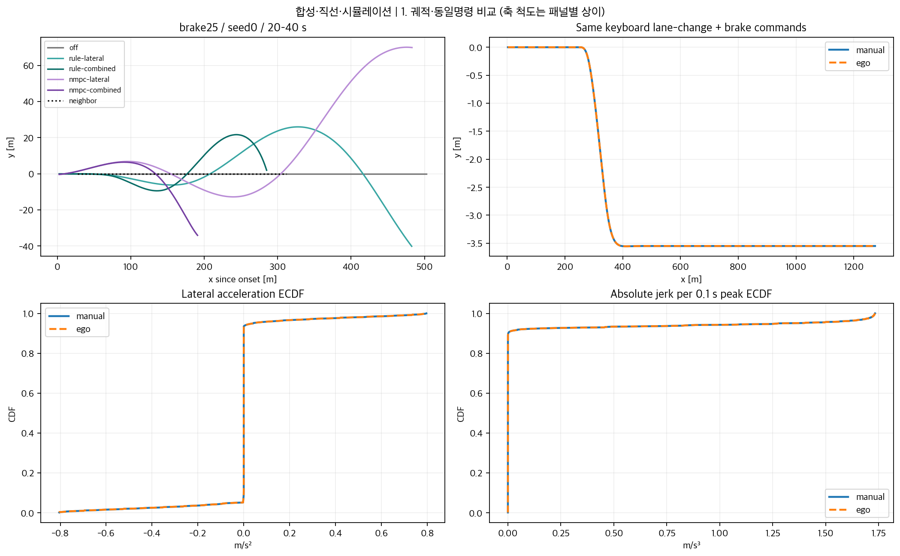
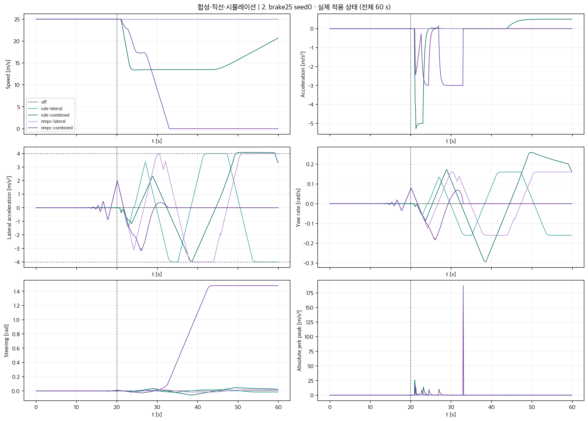
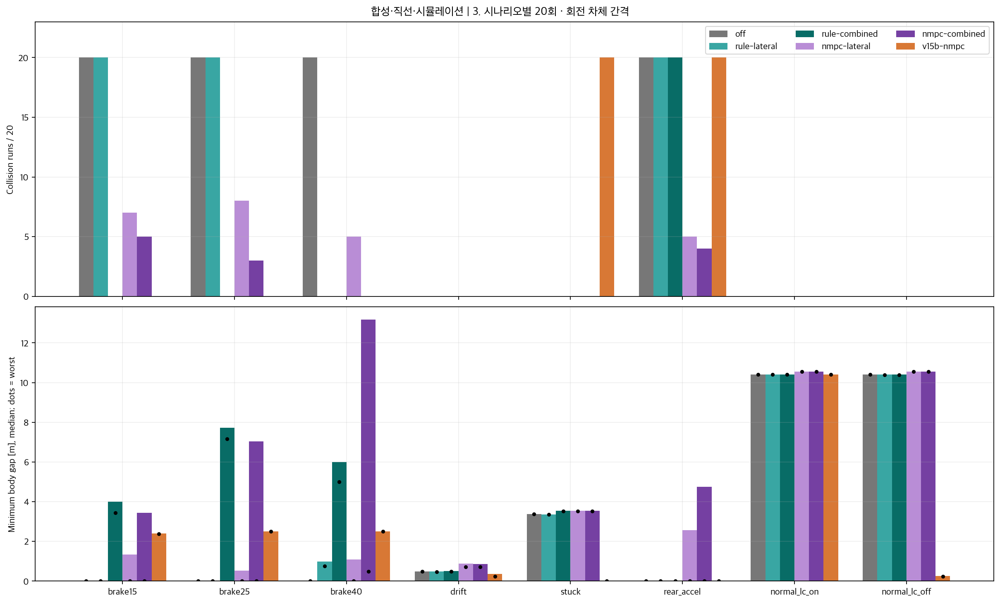
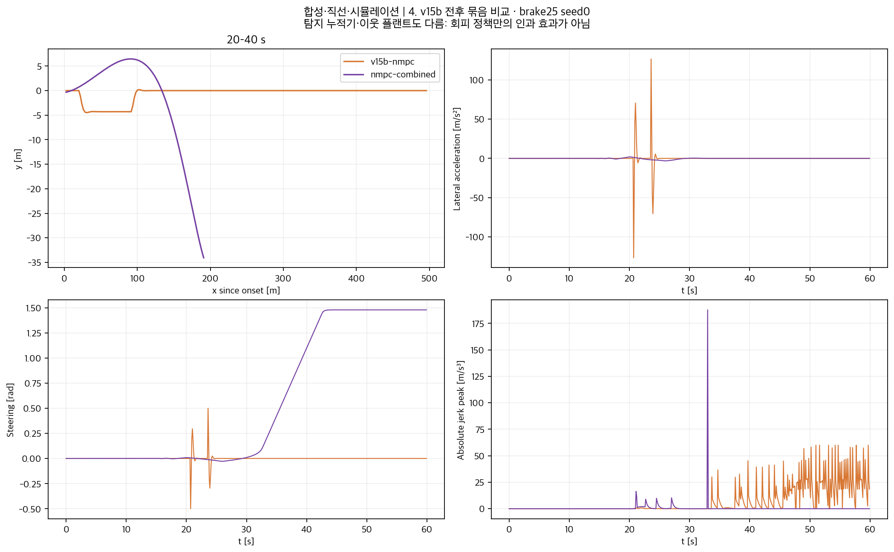

# 회피기동 검증 결과

**합성·직선·시뮬레이션. 실제 도로 성능 주장이 아니다.**

기존 demo_v15c의 탐지·누적·보정·홀드를 유지한 채 공통 Vehicle, 횡·종 회피, 복귀 참조, 화면 보간을 구현했다. [구현 전 고정 설계](DESIGN_FROZEN.md), [1단계 진단](DIAGNOSIS_PHASE1.md).

800회 신규 + 160회 v15b 비교를 완료했다. 8시나리오×시드0–19, 각60초, 주입20초, 배경OFF. 20회 차이는 센서 잡음이며 다양한 운전자/도로에 대한 반복이 아니다. 저장 오류 1건만 수정했으며 결과를 보고 제어·탐지 임계값을 변경하지 않았다.

**판정: 자연스러운 회피·복귀 기준 미달.** 규칙 combined는 도로 중심 이탈58/160, NMPC combined는 이탈160/160·종료 시 정지160/160·복귀 완료0이다. 충돌 감소만으로 성공이라 평가할 수 없다.

## 충돌과 최소 간격

각 칸은 충돌 run/20; 최솟값0은 차체 접촉/겹침이다. 충돌 후에도 로그를 이어가므로 이후 회피·복귀가 이전 충돌을 취소하지 않는다.

| 시나리오 | off | rule-lateral | rule-combined | nmpc-lateral | nmpc-combined | v15b-nmpc |
|---|---|---|---|---|---|---|
| brake15 | 20/20 | 20/20 | 0/20 | 7/20 | 5/20 | 0/20 |
| brake25 | 20/20 | 20/20 | 0/20 | 8/20 | 3/20 | 0/20 |
| brake40 | 20/20 | 0/20 | 0/20 | 5/20 | 0/20 | 0/20 |
| drift | 0/20 | 0/20 | 0/20 | 0/20 | 0/20 | 0/20 |
| stuck | 0/20 | 0/20 | 0/20 | 0/20 | 0/20 | 20/20 |
| rear_accel | 20/20 | 20/20 | 20/20 | 5/20 | 4/20 | 20/20 |
| normal_lc_on | 0/20 | 0/20 | 0/20 | 0/20 | 0/20 | 0/20 |
| normal_lc_off | 0/20 | 0/20 | 0/20 | 0/20 | 0/20 | 0/20 |

| 조합 | 충돌 run/160 | 충돌 사건 | 최소 간격 worst / median m | 시작 / 횡목표 완료 / 복귀 완료 |
|---|---|---|---|---|
| off | 80/160 | 80 | 0.000 / 0.243 | 0 / 0 / 0 |
| rule-lateral | 60/160 | 60 | 0.000 / 0.635 | 140 / 53 / 67 |
| rule-combined | 20/160 | 20 | 0.000 / 4.676 | 140 / 30 / 78 |
| nmpc-lateral | 25/160 | 25 | 0.000 / 3.539 | 64 / 1 / 0 |
| nmpc-combined | 12/160 | 14 | 0.000 / 5.936 | 63 / 1 / 0 |
| v15b-nmpc | 40/160 | 65 | 0.000 / 1.385 | 140 / 140 / 0 |

## 추종 실패: 충돌 수만으로 성공 판정 불가

도로는 중심0, 3차로×3.5m이므로 |Y|>5.25m는 자차 중심 자체가 도로 밖인 경우다. 차체 일부 이탈보다 보수적인 집계이며 안전 통과 기준을 새로 만든 것이 아니다. 충돌 후 물리 충격은 모델링하지 않고 궤적을 계속 적분한다.

| 조합 | 중심 도로 이탈 run/160 | 최대 \|Y\| m | 60초 시점 완전 정지 run |
|---|---|---|---|
| off | 0 | 0.00 | 0 |
| rule-lateral | 60 | 121.22 | 0 |
| rule-combined | 58 | 241.17 | 0 |
| nmpc-lateral | 160 | 154.57 | 0 |
| nmpc-combined | 160 | 53.23 | 160 |
| v15b-nmpc | 0 | 4.88 | 0 |

공통 플랜트의 한계를 지키더라도 폐루프 횡추종은 안정적이라고 볼 수 없다. 기존 이득/4초 참조와 새 조향 변화율·지연의 조합에서 진동·이탈이 관측됐다. NMPC 모델 불일치와 반복 fallback도 정지·복귀 실패와 함께 나타났다. 원인 분리를 위한 추가 실험 없이 하나의 원인으로 단정하지 않는다. 기준 미달을 인정하며 결과 후 이득·시간·임계값 튜닝은 하지 않았다.

## 물리 지표와 사전 기준 판정

모든 적용 서브스텝을 집계. normal은 비상 단계가 아닌 구간 전체(평상·회피·복귀 포함)를 보수적으로 검사했다. jerk는 100Hz 적용 가속 차분, v15b는10Hz 차분이라 대역이 다르다.

| 조합 | a min/max | \|a_lat\| max (normal/emergency) | \|jerk\| max | \|δ̇\| max | \|r\| max | \|δ\| max rad | slip max ° |
|---|---|---|---|---|---|---|---|
| off | 0.000/0.000 | 0.000/0.000 | 0.00 | 0.00000 | 0.0000 | 0.000 | 0.00e+00 |
| rule-lateral | 0.000/0.000 | 4.773/4.786 | 0.00 | 0.00540 | 0.1914 | 0.021 | 2.18e-11 |
| rule-combined | -7.996/0.500 | 4.121/1.301 | 26.23 | 0.02487 | 0.3784 | 0.099 | 3.32e-11 |
| nmpc-lateral | 0.000/0.000 | 4.000/3.949 | 0.00 | 0.00540 | 0.1600 | 0.017 | 2.48e-11 |
| nmpc-combined | -7.999/3.000 | 4.183/3.803 | 543.17 | 0.13500 | 0.4717 | 1.478 | 2.75e-05 |
| v15b-nmpc | -5.000/3.000 | 147.955/0.000 | 80.00 | 10.00000 | 5.4704 | 0.500 | 1.04e-12 |

| 조합 | normal >4 run | emergency >8 run | a 한계 위반 | δ̇ 한계 위반 | slip >5° | 10Hz 끝 heading 차이 max ° |
|---|---|---|---|---|---|---|
| off | 0 | 0 | 0 | 0 | 0 | 0.00 |
| rule-lateral | 1 | 0 | 0 | 0 | 0 | 0.54 |
| rule-combined | 58 | 0 | 0 | 0 | 0 | 1.08 |
| nmpc-lateral | 0 | 0 | 0 | 0 | 0 | 0.46 |
| nmpc-combined | 2 | 0 | 0 | 0 | 0 | 1.35 |
| v15b-nmpc | 140 | 0 | 0 | 140 | 0 | 31.34 |

슬립은 모델의 속도 방향과 동일 시각 heading의 일치 검사다. 기구학 모델의 구조적 성질이며 실제 타이어 슬립 검증이 아니다. v15b의 전진 Euler 시작 heading, 새 모델의 중점 heading에 대응한다. 10Hz 끝 heading 차이는 별도 열로 공개했다. v15b에는 비상 단계가 없어 emergency=0이다.

## 풀이와 제한

풀이 시간은 6개 작업 프로세스 병렬 CPU 부하에서 관측한 값. 평균만으로 실시간성을 주장하지 않는다. 명령클립은 10Hz 어댑터, plant steer/rate/speed 제한은100Hz 서브스텝 건수다.

| 조합 | solve ms p50 / p90 / p99 / max | fallback 전체 / 회피·복귀 | 어댑터 조향클립 | plant a / δ / δ̇ / 속도 |
|---|---|---|---|---|
| off | 0.00 / 0.00 / 0.00 / 0.00 | 0 / 0 | 0 | 0 / 0 / 0 / 0 |
| rule-lateral | 0.00 / 0.00 / 0.00 / 0.00 | 0 / 0 | 18712 | 0 / 0 / 143502 / 0 |
| rule-combined | 0.00 / 0.00 / 0.00 / 0.00 | 0 / 0 | 17720 | 0 / 0 / 183362 / 0 |
| nmpc-lateral | 9.19 / 17.29 / 32.38 / 108.20 | 58274 / 21259 | 68579 | 0 / 0 / 417585 / 0 |
| nmpc-combined | 6.03 / 11.27 / 31.11 / 54.40 | 58710 / 20339 | 68651 | 0 / 22 / 419348 / 0 |
| v15b-nmpc | 6.16 / 29.75 / 49.23 / 92.61 | 3873 / 0 | 0 | 0 / 0 / 0 / 0 |

## 회피·완료·복귀 시각

아래는 실행 시작 기준 중앙값 초. 조건을 달성한 run만의 중앙값이므로 완료/복귀 개수를 같이 읽어야 한다. N/A는 60초 안에 해당 이벤트가 없었다는 뜻이다. 시각 20을 빼면 주입 이후 시간. 횡목표 완료보다 먼저 위험 해소로 복귀를 시작할 수도 있다.

| 조합/시나리오 | 회피 진입 n | 시작 s | 횡목표 완료 s (n) | 복귀 시작 s | 복귀 완료 s (n) |
|---|---|---|---|---|---|
| rule-lateral/brake15 | 20 | 20.40 | N/A (0) | 23.30 | 28.90 (4) |
| rule-lateral/brake25 | 20 | 20.40 | N/A (0) | 24.10 | 27.70 (3) |
| rule-lateral/brake40 | 20 | 20.40 | N/A (0) | 25.40 | N/A (0) |
| rule-lateral/drift | 20 | 28.60 | 33.40 (13) | 32.20 | N/A (0) |
| rule-lateral/stuck | 20 | 22.80 | 27.50 (20) | 29.55 | 33.35 (20) |
| rule-lateral/rear_accel | 20 | 24.10 | 28.80 (20) | 31.40 | 35.20 (20) |
| rule-lateral/normal_lc_on | 0 | N/A | N/A (0) | N/A | N/A (0) |
| rule-lateral/normal_lc_off | 20 | 21.70 | N/A (0) | 24.70 | 30.20 (20) |
| rule-combined/brake15 | 20 | 20.40 | 23.30 (4) | 30.15 | N/A (0) |
| rule-combined/brake25 | 20 | 20.40 | N/A (0) | 43.50 | N/A (0) |
| rule-combined/brake40 | 20 | 20.40 | N/A (0) | 45.20 | N/A (0) |
| rule-combined/drift | 20 | 28.60 | 33.70 (6) | 32.05 | 48.50 (18) |
| rule-combined/stuck | 20 | 22.80 | 28.00 (20) | 29.55 | 45.95 (20) |
| rule-combined/rear_accel | 20 | 24.10 | N/A (0) | 28.30 | 44.70 (20) |
| rule-combined/normal_lc_on | 0 | N/A | N/A (0) | N/A | N/A (0) |
| rule-combined/normal_lc_off | 20 | 21.70 | N/A (0) | 24.70 | 30.20 (20) |
| nmpc-lateral/brake15 | 19 | 20.40 | N/A (0) | 23.30 | N/A (0) |
| nmpc-lateral/brake25 | 20 | 20.40 | N/A (0) | 24.10 | N/A (0) |
| nmpc-lateral/brake40 | 20 | 20.40 | 21.30 (1) | 25.40 | N/A (0) |
| nmpc-lateral/drift | 0 | N/A | N/A (0) | N/A | N/A (0) |
| nmpc-lateral/stuck | 0 | N/A | N/A (0) | N/A | N/A (0) |
| nmpc-lateral/rear_accel | 5 | 24.10 | N/A (0) | 30.40 | N/A (0) |
| nmpc-lateral/normal_lc_on | 0 | N/A | N/A (0) | N/A | N/A (0) |
| nmpc-lateral/normal_lc_off | 0 | N/A | N/A (0) | N/A | N/A (0) |
| nmpc-combined/brake15 | 20 | 20.40 | N/A (0) | 25.55 | N/A (0) |
| nmpc-combined/brake25 | 20 | 20.40 | N/A (0) | 30.30 | N/A (0) |
| nmpc-combined/brake40 | 20 | 20.40 | 21.30 (1) | 31.00 | N/A (0) |
| nmpc-combined/drift | 0 | N/A | N/A (0) | N/A | N/A (0) |
| nmpc-combined/stuck | 0 | N/A | N/A (0) | N/A | N/A (0) |
| nmpc-combined/rear_accel | 3 | 24.00 | N/A (0) | 27.90 | N/A (0) |
| nmpc-combined/normal_lc_on | 0 | N/A | N/A (0) | N/A | N/A (0) |
| nmpc-combined/normal_lc_off | 0 | N/A | N/A (0) | N/A | N/A (0) |
| v15b-nmpc/brake15 | 20 | 20.10 | 21.70 (20) | 22.60 | N/A (0) |
| v15b-nmpc/brake25 | 20 | 20.60 | 22.20 (20) | 23.50 | N/A (0) |
| v15b-nmpc/brake40 | 20 | 21.70 | 23.30 (20) | 24.70 | N/A (0) |
| v15b-nmpc/drift | 20 | 28.60 | 30.20 (20) | 36.80 | N/A (0) |
| v15b-nmpc/stuck | 20 | 22.75 | 24.35 (20) | 32.50 | N/A (0) |
| v15b-nmpc/rear_accel | 20 | 23.70 | 25.30 (20) | N/A | N/A (0) |
| v15b-nmpc/normal_lc_on | 0 | N/A | N/A (0) | N/A | N/A (0) |
| v15b-nmpc/normal_lc_off | 20 | 21.60 | 23.20 (20) | 34.80 | N/A (0) |

## 정상 차선변경의 경보·불필요 반응

정상 차선변경 두 조건은 정답상 정상이다. 경보와 실제 반응을 분리했다. 실제 움직임은20초 이후 |Y|>.1m 또는 a<−1m/s²; NMPC가 경보 전 자체 제약으로 움직인 것도 포함된다.

| 조합/조건 | 탐지경보 / 반응경보 / AVOIDING (각/20) | 실제 움직임 / 주입 전 움직임 (각/20) |
|---|---|---|
| off/normal_lc_on | 0 / 0 / 0 | 0 / 0 |
| off/normal_lc_off | 20 / 20 / 0 | 0 / 0 |
| rule-lateral/normal_lc_on | 0 / 0 / 0 | 0 / 0 |
| rule-lateral/normal_lc_off | 20 / 20 / 20 | 20 / 0 |
| rule-combined/normal_lc_on | 0 / 0 / 0 | 0 / 0 |
| rule-combined/normal_lc_off | 20 / 20 / 20 | 20 / 0 |
| nmpc-lateral/normal_lc_on | 0 / 0 / 0 | 20 / 20 |
| nmpc-lateral/normal_lc_off | 20 / 20 / 0 | 20 / 20 |
| nmpc-combined/normal_lc_on | 0 / 0 / 0 | 20 / 20 |
| nmpc-combined/normal_lc_off | 20 / 20 / 0 | 20 / 20 |
| v15b-nmpc/normal_lc_on | 0 / 0 / 0 | 0 / 0 |
| v15b-nmpc/normal_lc_off | 20 / 20 / 20 | 20 / 0 |

## 동일 동작·보존·화면 확인

- 독립 Vehicle 두 개에 같은 키보드 차선변경+제동 명령600개를 넣은 궤적 최대 차이: **0.0e+00**, a/a_lat/jerk를 포함한 적용 지표 사전도 일치(허용1e−9).
- 극한 입력의 횡가속 최대 7.99999639m/s², 조향 변화율 초과 1.78e-15rad/s(부동소수 오차).
- 보호 대상 23개 SHA-256 일치: v15b 코드, 원본 planning/Config 등, v15c detector.py/accum.py. 고정 관측의 탐지/누적 반복 출력 일치.
- 실제 Pygame 루프를 dummy 디스플레이에서 실행해 C 모드/B 엔진 전환·보간·회전 렌더링을 확인했다. 실디스플레이의 지속60FPS 성능은 측정하지 않았다.

## 그림

대표는 사전 지정한 brake25 seed0이며 성공 사례를 골라 바꾸지 않았다. x–y 패널은20–40초, 시계열은전체60초다.

## 알려진 한계

- NMPC 내부 예측에는 새 플랜트 액추에이터 지연/변화율 상태가 없다. 제약·가중치는 원본 그대로여서 최적화 예측과 실제 추종의 차이, fallback, 명령 클립이 남는다.
- v15b 전후 비교는 기존 누적기와 이웃 플랜트도 다른 묶음 비교다. 신규5조합이 같은 플랜트·누적기를 쓰는 통제 비교다. 이전 v15b 충돌 검사는10Hz 상태를 보간하므로 신규100Hz 검사와 완전히 동일하지 않다.
- 정상 횡가속4 기준 또는60초 내 복귀 미달은 위 표에 그대로 남겼다. 결과를 보고 임계값을 바꾸지 않았다. 미회피/미복귀/충돌 run은 성공으로 세지 않았다.
- 저속/정지에서는 속도별 횡가속 한계만으로 큰 조향각이 허용된다(약1.52rad). 별도 기계적 조향각 상한은 이번 고정 설계에 없었다. 정지 시 v≥0 클립으로 가속도가0으로 전환되며 큰 저크가 생긴다. 이 역시 자연스러움의 한계다.
- 실제 이웃 x/heading 및 잡음 관측 y/v/r을 쓰고 이웃 한 대만 있다. 배경OFF, 직선, 합성 입력, 신호 관측 가능 가정이다. 초기중심간격과 범퍼간격은4.5m 차이난다.
- 새 물리 모델은 기존 위치 직접가산 주입을 명령으로 바꿨으므로 drift/stuck/정상 차선변경의 탐지 결과도 달라질 수 있다. 탐지기를 재보정하지 않았다.
- 기존 docs/ 웹 명세 및 README_preavoid.md는 변경 전 계약/설명이며 새 모드·입력 단위·충돌 기하와 다르다. 이번 작업에서 웹 API는 구현하지 않았다.

## 재현 자료

집계: results/avoidance/summary.json, scenario_summary.csv. 개별960개 run 요약과10Hz 압축 로그: private/avoidance/runs, traces. 고정 해시/오류 수정 이력: private/avoidance/evaluation_manifest*.json. 원시 로그·모델·UAH 파생물은 커밋 제외. 실행법과 변경 파일은 README 마지막 절.
